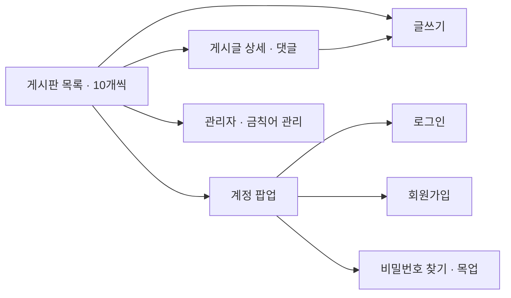
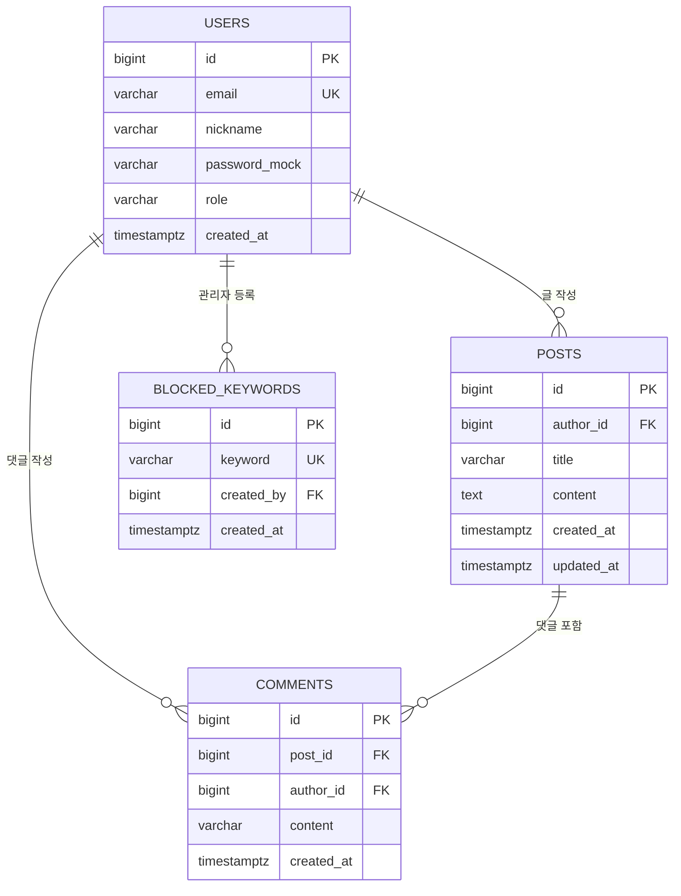

# note-demo — 최소 화면 및 데이터 설계

## 1. 최소 화면 구성

회원가입·로그인·비밀번호 찾기는 하나의 계정 팝업에서 전환한다. 로그아웃은 상단 버튼으로 제공한다.

| 화면 | 주요 구성 | 접근 및 동작 |
| --- | --- | --- |
| 게시판 목록 | 번호, **제목**, 작성자, 작성일, 제목 검색, 페이지 번호, 글쓰기 | 비회원도 조회. 본문은 목록에 노출하지 않는다. 기본 10개씩 최신순 조회. |
| 게시글 상세 | 제목, 작성자, 작성일, 내용, 댓글 목록·입력 | 비회원도 조회. 댓글 등록은 로그인 필요. 수정·삭제는 작성자에게만 표시. 삭제 전 확인. |
| 글쓰기·수정 | 제목, 내용, 등록·취소 | 로그인 필요. 수정은 작성자만 가능. 동일한 입력 화면을 재사용. |
| 계정 팝업 | 로그인 / 회원가입 / 비밀번호 찾기 | 가입: 이메일·닉네임·비밀번호. 찾기: 이메일 입력 후 목업 안내만 표시. 실제 이메일 전송·비밀번호 변경 없음. |
| 관리자 금칙어 관리 | 키워드 목록, 추가·삭제, 마스킹 미리보기, 참고 자료 | 관리자만 접근. 변경 즉시 기존 글·댓글에도 적용. |

‘내가 쓴 글’은 게시판 목록을 작성자로 필터링한 것으로, 별도 화면 구조를 만들지 않는다.

## 2. ERD

DB 연결 시 적용할 **4개 테이블** 설계다. 현재 실행 앱은 같은 주요 관계를 브라우저 저장소로 구현한 목업이며, 실제 DB는 연결하지 않는다. SQL 정의는 [schema.sql](../schema.sql)에 있다.

- 회원 1명은 게시글과 댓글을 각각 여러 개 작성한다.
- 게시글 1개에는 댓글 여러 개가 속한다. 글 삭제 시 해당 댓글도 삭제한다.
- 관리자 회원 1명은 금칙어 여러 개를 등록한다. 일반 회원은 금칙어를 변경할 수 없다.
- 금칙어는 특정 글에 귀속되지 않는 공통 사전이다. 글·댓글과 별도 매핑 테이블을 만들지 않고 표시할 때 적용한다.

## 3. 테이블 명세 (PostgreSQL)

### users — 회원

| 컬럼 | 자료형 | 제약·기본값 | 설명 |
| --- | --- | --- | --- |
| id | BIGINT | PK, IDENTITY | 회원 식별자 |
| email | VARCHAR(254) | NOT NULL, UNIQUE | 로그인 이메일. 저장 전 소문자·앞뒤 공백 제거 |
| nickname | VARCHAR(20) | NOT NULL, 2~20자 | 이름 또는 닉네임 |
| password_mock | VARCHAR(100) | NOT NULL, 6~100자 | **목업 전용 평문**. 실제 서비스 도입 전 password_hash로 교체 |
| role | VARCHAR(10) | NOT NULL, 기본 MEMBER | MEMBER 또는 ADMIN. 신규 가입은 MEMBER 고정 |
| created_at | TIMESTAMPTZ | NOT NULL, 현재 시각 | 가입 시각 |

향후 SNS 로그인 도입 시 공급자·외부 사용자 ID를 저장하는 인증 계정 테이블을 추가한다. 현재 범위에는 포함하지 않는다.

### posts — 게시글

| 컬럼 | 자료형 | 제약·기본값 | 설명 |
| --- | --- | --- | --- |
| id | BIGINT | PK, IDENTITY | 게시글 식별자 |
| author_id | BIGINT | NOT NULL, FK → users.id | 작성자 |
| title | VARCHAR(100) | NOT NULL, 공백만 입력 불가 | 제목 |
| content | TEXT | NOT NULL, 1~10,000자 | 본문 원문 |
| created_at | TIMESTAMPTZ | NOT NULL, 현재 시각 | 등록 시각 |
| updated_at | TIMESTAMPTZ | NULL 허용 | 수정 시각. 수정 처리 시 갱신 |

### comments — 댓글

| 컬럼 | 자료형 | 제약·기본값 | 설명 |
| --- | --- | --- | --- |
| id | BIGINT | PK, IDENTITY | 댓글 식별자 |
| post_id | BIGINT | NOT NULL, FK → posts.id, ON DELETE CASCADE | 대상 게시글 |
| author_id | BIGINT | NOT NULL, FK → users.id | 댓글 작성자 |
| content | VARCHAR(1000) | NOT NULL, 공백만 입력 불가 | 댓글 원문 |
| created_at | TIMESTAMPTZ | NOT NULL, 현재 시각 | 등록 시각 |

### blocked_keywords — 공통 금칙어

| 컬럼 | 자료형 | 제약·기본값 | 설명 |
| --- | --- | --- | --- |
| id | BIGINT | PK, IDENTITY | 금칙어 식별자 |
| keyword | VARCHAR(30) | NOT NULL, 대소문자 무시 UNIQUE | 마스킹할 문자열. 저장 전 NFKC 정규화·소문자·앞뒤 공백 제거 |
| created_by | BIGINT | NOT NULL, FK → users.id | 등록한 관리자 |
| created_at | TIMESTAMPTZ | NOT NULL, 현재 시각 | 등록 시각 |

금칙어 유형은 요구사항의 ‘키워드 매핑 **또는** 정규식’ 중 키워드 방식을 선택한다. 입력 문자열을 이스케이프한 정규식으로 변환해 공백·숫자·일부 기호를 끼워 넣은 변형도 감지한다. 관리자가 임의 정규식을 실행하는 기능은 제공하지 않는다.

## 4. 처리 규칙

| 항목 | 규칙 |
| --- | --- |
| 권한 | 조회는 공개. 작성·댓글은 회원. 글 수정·삭제는 `현재 회원 ID = author_id`. 금칙어 관리는 `role = ADMIN`. |
| 페이징 | 기본 10개. `created_at DESC, id DESC`로 안정적인 최신순 정렬. 총 개수로 페이지 수 계산. |
| 마스킹 | 제목·본문·댓글·닉네임 출력 시 공통 사전을 적용. 일치한 부분을 `*`로 치환. 원문은 수정용으로 보관. |
| 사전 변경 | 새 키워드가 기존 게시글·댓글에도 바로 적용됨. 키워드를 삭제하면 해당 표현은 다시 표시될 수 있음. |
| 중복 | 이메일·금칙어 중복 등록 차단. 닉네임은 중복 허용. |
| 삭제 | 게시글은 실제 삭제하며 연결된 댓글도 삭제. 회원 탈퇴·댓글 수정·삭제·대댓글은 현재 범위에 없음. |
| 비밀번호 찾기 | 화면 목업만 제공. 전송 성공으로 오인하지 않도록 실제 이메일 미전송을 명시. |

FK는 연결 대상의 존재만 보장한다. 작성자 일치, 관리자 역할, 이메일 검증, 업데이트 시각 갱신은 DB 연결 시 서버에서도 검사해야 한다. 현재 브라우저 목업의 권한 검사는 보안 경계를 제공하지 않는다.

## 5. 초기 금칙어 자료

조사일: **2026-10-27**. 공개 구현의 대표적인 비속어 예시를 참고해 한국어·초성·영어의 최소 목록 14개를 직접 선정했다. 외부 전체 DB를 복제하거나 최신 표현 전체를 포괄하는 목록으로 간주하지 않는다. 외부 사전 자동 동기화는 없으며 관리자 추가·삭제로 보완한다.

- [한국어 욕설 필터의 공개 구현과 예시](https://github.com/Xim-ya/korean_profanity_filter): 한국어 변형 및 초성 처리 참고.
- [KISO 운영 정책](https://kiso.or.kr/policy-guide/policy-regulations): 욕설·비속어 및 차별적 표현 관련 운영 방향 참고.
- [KISO 욕설방지시스템의 네이트 DB 추가 안내, 2025-07](https://www.kiso.or.kr/wp-content/uploads/2025/07/KISO-%EB%B3%B4%EB%8F%84%EC%9E%90%EB%A3%8C-KISO-%EC%9A%95%EC%84%A4%EB%B0%A9%EC%A7%80%EC%8B%9C%EC%8A%A4%ED%85%9C%EC%97%90-%EB%84%A4%EC%9D%B4%ED%8A%B8-DB-%EC%B6%94%EA%B0%80_250711.pdf): 지속적으로 사전을 보완하는 운영 사례. 해당 서비스의 유료·비공개 DB는 사용하지 않음.

단순 문자열 필터는 문맥을 이해하지 못해 오탐·누락이 생길 수 있다. 애매한 단어·사람 이름·일반 명사는 초기 목록에서 제외했으며, 관리 화면에서 미리보기로 조정한다.
