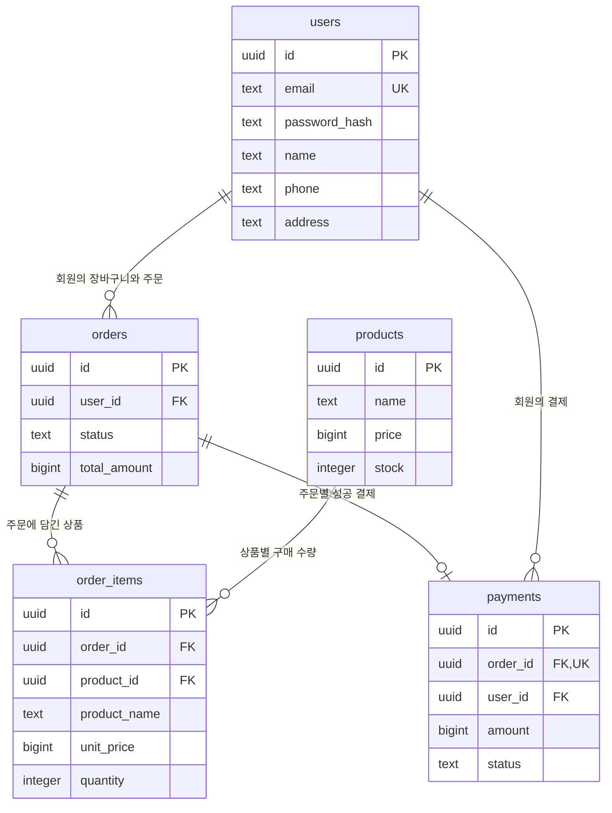

# 쇼핑몰 최소 ERD

회원가입부터 구매내역 확인까지 필요한 **테이블 5개**로 구성합니다. 장바구니 전용 테이블은 만들지 않고 `orders.status`로 장바구니와 주문을 구분합니다.

이 그림은 구매 흐름을 이해하는 데 필요한 핵심 컬럼만 표시합니다. 실제 SQL에 있는 화면 표시·보안·관리용 컬럼까지 포함한 정의는 [테이블 정의서](table-definition.md)에 정리했습니다. 이번 정리는 문서 변경이며 기존 SQL과 소스코드는 변경하지 않습니다.

## 관계도

아래 코드 블록은 Mermaid 지원 Markdown 미리보기에서 다이어그램으로 표시됩니다. 같은 내용을 Mermaid 원본 파일 [erd.mmd](erd.mmd)로도 제공합니다.

## 테이블 역할

| 테이블 | 한 행이 의미하는 것 | 예시 |
| --- | --- | --- |
| `users` | 회원 한 명 | 홍길동 회원 |
| `products` | 판매 상품 한 종류 | 18,000원 머그 |
| `orders` | 회원의 장바구니 또는 주문 한 건 | 홍길동의 총 36,000원 주문 |
| `order_items` | 장바구니·주문에 담긴 상품 한 종류 | 위 주문에 담긴 머그 2개 |
| `payments` | 주문 한 건의 성공한 모의 결제 | 36,000원 결제 완료 |

## 관계 읽는 법

- 회원 한 명은 여러 주문을 가집니다: `users` → `orders`는 **1:N**입니다.
- 주문 한 건에는 여러 상품 항목이 들어갑니다: `orders` → `order_items`는 **1:N**입니다. 빈 장바구니는 항목이 0개일 수도 있습니다.
- 같은 상품은 여러 주문에 들어갑니다: `products` → `order_items`는 **1:N**입니다.
- 따라서 주문과 상품은 `order_items`를 사이에 둔 **N:M** 관계입니다.
- 주문 한 건에 성공 결제는 최대 한 건입니다: `orders` → `payments`는 **1:0..1**입니다.

`PK`는 각 행의 고유 번호, `FK`는 다른 테이블을 연결하는 번호, `UK`는 중복될 수 없는 값입니다.

## 주문 상태

| 상태 | 의미 | 결제 이력 |
| --- | --- | --- |
| `CART` | 장바구니 | 없음 |
| `ORDERED` | 주문 확정, 결제 대기 | 없음 |
| `PAID` | 결제 완료 | 성공 결제 1건 |
| `CANCELED` | 결제 전 취소 | 없음 |

일반적인 흐름은 `CART → ORDERED → PAID`입니다. 바로 구매는 `ORDERED`부터 시작합니다. 사용자당 활성 `CART`는 최대 하나이며, 실제 재고는 **결제 성공 시점**에만 차감합니다.

다음 문서: [구매 과정 시뮬레이션](purchase-simulation.md) · [테이블 정의서](table-definition.md)
