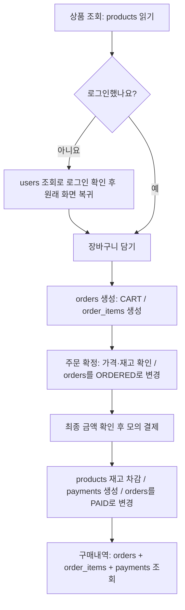

# 상품 구매 시뮬레이션 — 테이블에서 보는 흐름

홍길동 회원이 **18,000원짜리 머그 2개를 장바구니에 담고 36,000원을 모의 결제**하는 예시입니다. 배송비는 0원입니다.

`U1`, `P1`, `O1`, `I1`, `PAY1`은 설명을 위해 줄인 번호입니다. 실제 DB에는 UUID가 저장됩니다. 아래 표는 이해를 위한 예시이며 실제 DB 실행 결과는 아닙니다.

## 전체 흐름

## 1. 시작 데이터

회원가입을 마치면 `users`에 회원이 한 명 있습니다. 비밀번호는 원문 대신 bcrypt 해시로 저장합니다.

| users.id | email | name | password_hash |
| --- | --- | --- | --- |
| U1 | hong@example.com | 홍길동 | bcrypt 해시 |

판매 상품은 `products`에 등록되어 있습니다.

| products.id | name | price | stock |
| --- | --- | ---: | ---: |
| P1 | 모닝 세라믹 머그 | 18,000 | 40 |

아직 `orders`, `order_items`, `payments`에는 이 구매와 관련된 행이 없습니다.

## 2. 상품 조회·로그인

상품 목록·상세에서는 **products를 SELECT**합니다. 조회만으로 주문·결제 데이터나 재고가 바뀌지 않습니다.

비로그인 사용자가 구매를 선택하면 로그인 화면으로 이동합니다. 로그인에서는 **users를 SELECT**하고 입력한 비밀번호와 해시를 비교합니다. 성공하면 쿠키를 발급하고 직전 화면으로 복귀합니다. 이 단계에서도 주문·결제 행을 생성하지 않습니다.

## 3. 머그 2개를 장바구니에 담기

`orders`에 홍길동의 장바구니를 만들고 `order_items`에 상품과 수량을 저장합니다. 이미 활성 장바구니가 있다면 그 행을 사용합니다.

**orders — 장바구니 1행 생성**

| id | user_id | status | total_amount |
| --- | --- | --- | ---: |
| O1 | U1 | CART | 36,000 |

**order_items — 장바구니의 상품 1행 생성**

| id | order_id | product_id | product_name | unit_price | quantity |
| --- | --- | --- | --- | ---: | ---: |
| I1 | O1 | P1 | 모닝 세라믹 머그 | 18,000 | 2 |

장바구니는 **O1이라는 상자**, order_items의 I1은 **그 안의 머그 2개 항목**이라고 보면 됩니다. 수량이 2개여도 행은 1개입니다. 다른 종류의 상품을 담으면 항목 행이 추가됩니다.

이때 상품 재고는 여전히 **40개**, 결제 행은 **0개**입니다. 장바구니에 담는 것은 재고 예약이 아닙니다.

## 4. 배송정보 입력 후 주문 확정

서버는 상품의 현재 가격과 재고를 확인하고, 주문 항목의 상품명·단가를 확정합니다. `orders`의 같은 O1 행을 `CART → ORDERED`로 바꿉니다.

| orders.id | status 변경 | total_amount | recipient | phone | address | ordered_at |
| --- | --- | ---: | --- | --- | --- | --- |
| O1 | CART → ORDERED | 36,000 | 홍길동 | 010-1234-5678 | 서울시 예시로 123 | 주문 확정 시각 |

이 예시에서는 상품 가격이 그대로이므로 총액도 36,000원입니다. 사용자는 확정된 금액을 보고 결제를 선택합니다. **재고는 아직 40개이고 payments는 비어 있습니다.**

이후 상품 마스터 가격이 바뀌더라도 O1에 저장한 `order_items.unit_price`는 18,000원을 유지합니다.

## 5. 모의 결제 성공

다음 세 작업을 **하나의 트랜잭션**으로 처리합니다. 하나라도 실패하면 모두 이전 상태로 되돌립니다.

| 처리 | 테이블 | 변경 내용 |
| --- | --- | --- |
| 재고 차감 | products | P1의 stock: **40 → 38** |
| 결제 이력 추가 | payments | O1에 대한 성공 결제 **1행 생성** |
| 주문 완료 표시 | orders | O1의 status: **ORDERED → PAID**, paid_at 저장 |

**payments — 결제 결과**

| id | order_id | user_id | amount | status | method |
| --- | --- | --- | ---: | --- | --- |
| PAY1 | O1 | U1 | 36,000 | SUCCEEDED | MOCK |

**orders — 최종 상태**

| id | user_id | status | total_amount | paid_at |
| --- | --- | --- | ---: | --- |
| O1 | U1 | PAID | 36,000 | 결제 완료 시각 |

`users`와 `order_items`는 결제 때문에 바뀌지 않습니다. 결제가 완료되면 화면은 상품목록으로 이동합니다.

## 6. 구매내역 조회

현재 로그인한 회원의 `orders.user_id=U1`인 주문을 가져와 `order_items`와 `payments`를 연결합니다. 구매내역에는 결제 대기·완료·취소 상태를 표시하며, 이 예시 O1은 **결제 완료**로 표시됩니다.

| 화면에 보여줄 정보 | 가져오는 곳 |
| --- | --- |
| 주문번호·상태·주문일 | orders |
| 구매 당시 상품명·가격·수량 | order_items |
| 결제번호·금액·결제일 | payments |

다른 회원의 주문번호를 입력해도 서버가 user_id를 함께 검사하므로 조회·결제할 수 없습니다.

## 바로 구매는 무엇이 다른가요?

장바구니 담기 단계를 건너뛰고, **새 orders 행을 ORDERED로 생성**합니다. 상품 항목은 동일하게 order_items에 저장합니다. 기존 장바구니가 있더라도 그대로 유지합니다.

| 단계 | 장바구니 구매 | 바로 구매 |
| --- | --- | --- |
| 상품 선택 | orders=CART, order_items 생성·수정 | 화면에서 상품·수량 선택 |
| 배송정보 입력·주문 확정 | 기존 CART를 ORDERED로 변경 | 별도 ORDERED와 order_items 생성 |
| 모의 결제 | 재고 차감 + payments 생성 + PAID | 동일 |
| 구매내역 | 확정 주문 조회 | 동일 |

## 예외 상황도 테이블로 보기

| 상황 | 테이블 결과 |
| --- | --- |
| 결제 버튼을 다시 누름 | 기존 payments 1건을 반환, 재고 추가 차감 없음 |
| 다른 사람이 먼저 사서 재고가 부족함 | 전체 결제 롤백, ORDERED 유지, payments 추가 없음 |
| 결제 전 주문 취소 | orders를 CANCELED로 변경, 재고 변화 없음 |
| 결제된 주문 취소 요청 | 이번 최소 기능 범위에서는 거절, 데이터 변화 없음 |
| 결제 후 다시 장바구니 담기 | PAID 주문은 유지, 별도 CART 생성 |

문서 이동: [최소 ERD](erd.md) · [테이블 정의서](table-definition.md)
