# 수업내용정리

> Python 기초에서 DB·인증·소유자 접근 제어까지 · Day1–Day13 학습 노트  
> Day1~8 정리: 2026-10-23 · Day9~13 확장 분석: 2026-10-30

## 🗺️ 전체 아키텍처 — 코드가 서비스가 되는 여행

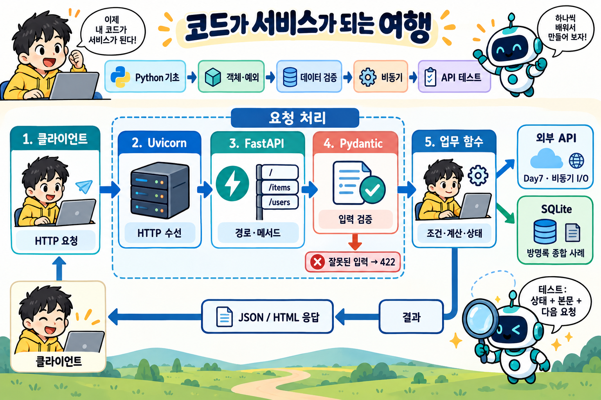

**읽는 순서:** 클라이언트의 HTTP 요청 → Uvicorn 수신 → FastAPI의 경로·메서드 선택 → Pydantic 입력 검증 → 업무 함수 → 응답입니다. 업무 함수는 필요에 따라 외부 API를 기다리거나 SQLite를 사용합니다. 이 두 가지는 선택적인 연결이며 모든 요청에서 연달아 실행되는 단계가 아닙니다.

그림은 역할을 나눈 개념도입니다. 입력 검증과 업무 함수 호출은 FastAPI의 요청 처리 안에서 이어집니다. SQLite는 별도 `Day1-Day8` 방명록 종합 사례, 외부 API와 비동기 I/O는 Day7에 해당합니다. FastAPI의 기본 입력 검증에 실패하면 422 응답을 보내며, 모든 종류의 오류가 422인 것은 아닙니다.

### Day9~13 확장 아키텍처

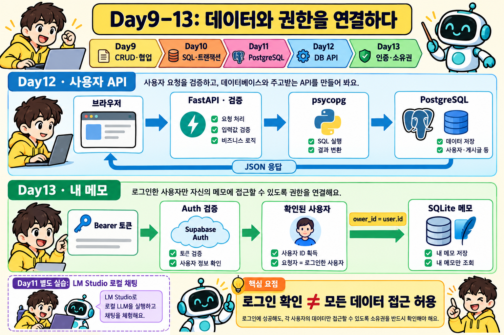

**앞선 그림은 Day1~8, 이 그림은 Day9~13을 연결합니다.** Day12의 사용자 API는 psycopg로 PostgreSQL에 직접 SQL을 전달합니다. Day13의 메모 API는 Supabase Auth로 사용자를 확인한 뒤 로컬 SQLite에서 그 사용자의 메모만 조회합니다. 서로 다른 실습이며 PostgreSQL에서 SQLite로 데이터가 자동 이동하지 않습니다. 그림의 PostgreSQL ‘게시글 등’은 관계형 저장소의 일반적인 예시이고, 현재 Day12 main의 직접 구현 대상은 사용자 등록·조회입니다. JSON 응답은 DB가 브라우저에 직접 전송하는 것이 아니라 FastAPI를 거쳐 반환됩니다.

## 🧭 이 자료를 읽는 방법

**입력받기 → 조건으로 판단하기 → 데이터를 구조화하기 → 검증하기 → API로 제공하기 → 테스트로 확인하기**의 흐름으로 복습합니다. 각 일자의 ‘직접 해보기’를 먼저 풀고 마지막의 답과 비교하세요.

이 문서는 원본 코드를 바탕으로 새로 작성한 해설입니다. ‘교정 예제’는 원본을 수정한 파일이 아니라 이해를 돕기 위한 예제입니다. 원본에는 학생 실습, 의도한 결함, 수정본, 정답이 섞여 있습니다.

| 구간 | 확인한 자료 | 학습의 중심 | 완료하면 할 수 있는 일 |
| --- | --- | --- | --- |
| Day1 | Day1/day1-1.py ~ day1-5.py | 변수·입력·조건·반복 | 숫자 게임과 짝수 필터 작성 |
| Day2 | Day2/오전, Day2/오후 | 논리·자료구조·컴프리헨션 | 권한 판별과 목록 가공 |
| Day3 | Day3/오전, Day3/오후 | 객체·예외·리팩터링 | 상태를 관리하고 잘못된 입력 처리 |
| Day4 | Day4/day4-1 | 인덱스·대입·교환 | 값이 덮어써지는 과정 설명 |
| Day5 | 해당 이름의 폴더 없음 | 수업 원본 미확인 | 아래 보충 FastAPI 자료로 연결 |
| Day6 | Day6/basemodel, ch04_validator, ch05_nested | Pydantic 모델·검증 | 입력 규칙을 선언하고 오류 위치 확인 |
| Day7 | Day7/01 ~ 03 | 비동기·HTTP·동시성 | 대기 시간을 겹치고 외부 응답 검사 |
| Day8 | Day8/lesson_01 ~ lesson_08 | 명세·입력·응답·상태 테스트 | 계약에서 기대값을 도출하고 회귀 검사 |
| Day9 | Day9/kdt_crud_pr_ai_review | CRUD·브랜치·PR·AI 리뷰 | 변경 범위와 회귀 근거를 갖춘 협업 |
| Day10 | Day10/lesson_01 ~ lesson_08 | SQL·트랜잭션·관계·JOIN | 저장·조회·소유권 규칙을 DB와 연결 |
| Day11 | Day11 + 관련 종합 프로젝트 | psycopg·PostgreSQL·로컬 LLM | DB 연결과 SQL CRUD, 스트리밍 대화 이해 |
| Day12 | Day12/main.py, lesson01.md | 환경변수·DB 기반 API | HTTP 입력을 SQL 저장·JSON 응답으로 연결 |
| Day13 | Day13/main.py ~ main3.py | Supabase Auth·Bearer·Depends | 로그인 사용자 확인과 내 메모 접근 제어 |

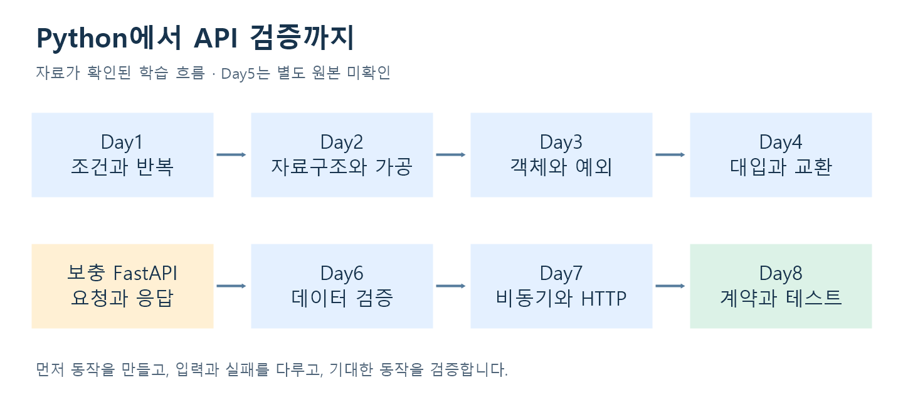

**범위 메모:** Day4는 확인한 코드가 짧아 다른 날짜와 같은 분량으로 확대하지 않았습니다. `05.FastAPI-uvicorn`과 `fastapi_win_vscode`는 FastAPI 보충 자료로 활용하며 Day5라고 단정하지 않습니다. `Day1-Day8` 방명록은 별도 종합 결과물로 다룹니다. `Day4/login.txt`의 내용은 정리에 포함하지 않았습니다.

## 01 · Day1 — 프로그램의 기본 흐름

### 핵심 개념

- **변수와 연산:** `number1 = 100`처럼 값을 이름에 연결하고 `+`, `*`, `%`로 계산합니다.
- **입력과 변환:** `input()`은 문자열을 반환합니다. 숫자 계산에는 `int()` 같은 변환이 필요하며 잘못된 입력은 예외가 될 수 있습니다.
- **조건:** 점수 60 이상이면 합격처럼 기준을 `if/else`로 표현합니다. `>=`는 경계값을 포함합니다.
- **반복:** 횟수가 정해지면 `for`, 조건을 만족할 때까지 반복하면 `while`을 사용합니다. `break`는 현재 반복문을 끝냅니다.
- **중첩 반복:** 구구단에서 바깥 반복은 단, 안쪽 반복은 곱하는 수를 바꿉니다. `range(2, 10)`에는 10이 포함되지 않습니다.

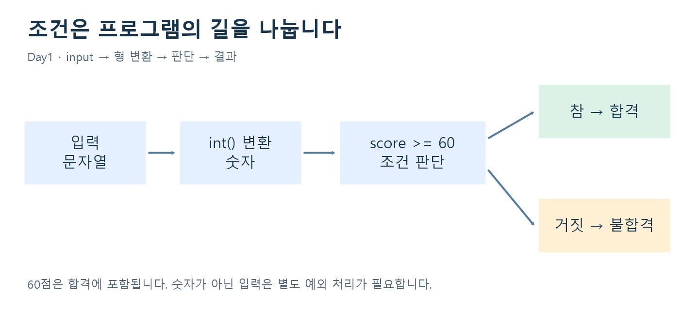

### 대표 실습: 숫자 다섯 개 중 짝수 찾기

원본 `Day1/day1-3.py`의 흐름을 간결하게 정리한 예제입니다.

```python
scores = []
for i in range(5):
    scores.append(int(input(f"{i + 1}번째 숫자: ")))

for score in scores:
    if score % 2 == 0:
        print(score)
```

`% 2`의 결과가 0이면 짝수입니다. 입력과 필터링을 나누면 각 단계의 역할을 확인하기 쉽습니다. 이 예제는 숫자가 아닌 입력의 예외 처리를 생략했습니다. 그 내용은 Day3에서 연결합니다.

### 숫자 맞추기에서 볼 점

`random.randint(1, 100)`은 양 끝을 포함한 정수를 만듭니다. 정답보다 큰지·작은지 비교하고, 정답이면 반복을 끝냅니다. 시도 횟수는 입력을 받을 때마다 증가시킵니다.

**원본 점검:** `day1-5.py`의 `print("정답입니다! 총 시도횟수는 : {count}")`는 앞에 `f`가 없어 `{count}`가 문자 그대로 출력됩니다. 교정하면 `print(f"정답입니다! 총 시도횟수는 : {count}")`입니다. 같은 파일에 게임 두 버전이 있어 첫 게임이 끝나도 다음 입력이 이어질 수 있습니다.

**직접 해보기:** 59·60·61을 입력하면 각각 합격인가요? `[1, 2, 3, 4, 5]`에서 짝수의 합과 개수를 계산해 보세요.

## 02 · Day2 — 판단 규칙과 데이터 가공

### 조건을 조립하는 법

| 표현 | 뜻 | 수업 예시 |
| --- | --- | --- |
| `A and B` | 두 조건이 모두 참 | 활성 계정이고 인증 완료 |
| `A or B` | 하나 이상이 참 | 관리자 또는 매니저 |
| `not A` | 조건의 반대 | 정지되지 않은 계정 |
| `x in values` | 목록 등에 포함 | 허용된 역할인지 확인 |
| `a if 조건 else b` | 조건에 따라 값 선택 | 합격·불합격 문자열 |

**단락 평가:** `and`는 앞이 거짓이면 뒤를 평가하지 않습니다. `user_profile is not None and user_profile.get("is_verified")`처럼 작성하면 None에 메서드를 호출하는 일을 피할 수 있습니다. 원본 `Day2/오전/day2-2.py`의 `use_profile`은 `user_profile`과 이름이 달라 실행 시 오류가 발생합니다.

### 자료구조를 선택하는 기준

| 자료구조 | 용도 | 주의할 점 |
| --- | --- | --- |
| list | 순서 있는 값들, 추가·수정 | 순회 중 원본을 삭제하면 항목을 건너뛸 수 있음 |
| dict | 이름과 값의 연결 | 없는 키를 `[]`로 읽으면 KeyError |
| tuple | 위치가 정해진 값의 묶음 | 요소 자체를 다시 대입할 수 없음 |
| set | 중복 제거·포함 검사 | 입력 순서를 보장하는 용도로 쓰지 않음 |

`dict(zip(["a", "b"], [100, 200]))`은 `{"a": 100, "b": 200}`을 만듭니다. 일반적인 `zip`은 가장 짧은 입력 길이에서 끝납니다.

### 대표 실습: 역할별 권한과 목록 필터

```python
for user in test_users:
    if user["is_suspended"]:
        print("정지된 계정입니다")
        continue
    role = user["user_role"]
    if role in ["admin", "manager"]:
        print("관리 기능 허용")
    elif role == "user":
        print("개인 데이터 조회")
    else:
        print("별도 정책 확인")

items = ["정상", "불량", "불량", "정상"]
clean = [item for item in items if item != "불량"]
```

위 권한 예제는 설명을 위해 원본보다 단순화했습니다. 실제 `day2-7.py`는 admin·manager·user·guest와 알 수 없는 역할을 각각 분리합니다.

`[i for i in numbers if i % 2 == 0]`는 일부 값만 남깁니다. `["성인" if age >= 20 else "미성년" for age in ages]`는 모든 값을 변환하므로 결과 개수가 같습니다.

**금칙어 전처리:** 빈 문자열 제거 → set으로 중복 제거 → 길이 내림차순 정렬 → join으로 연결합니다. 긴 단어부터 확인하는 규칙을 표현한 예입니다. 원본의 `set(1,2,3,...)` 호출은 잘못된 형식이며 `set([1,2,3])`처럼 하나의 iterable을 전달해야 합니다.

**직접 해보기:** `[20,15,60]`을 ‘성인/미성년’으로 바꾸는 결과와 성인만 남기는 결과를 각각 써 보세요. 정지 계정을 역할 검사보다 먼저 처리하는 이유도 설명해 보세요.

## 03 · Day3 — 객체, 예외, 유지보수하기 쉬운 코드

### 객체가 필요한 이유

바리스타 로봇은 원두량과 누적 추출 수를 기억하며 추출 동작을 수행합니다. 서로 다른 로봇 인스턴스는 상태를 따로 가집니다. 디지털 지갑은 잔액과 입금 동작을 묶고 setter로 음수 잔액을 거절합니다.

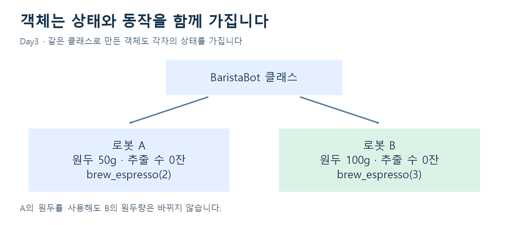

| 개념 | 수업 속 예 | 기억할 점 |
| --- | --- | --- |
| 생성자 `__init__` | 로봇 이름·원두 초기화 | 인스턴스 상태의 출발점 |
| 인스턴스 메서드 | `brew_espresso()` | `self`의 상태를 읽거나 변경 |
| property | 지갑의 balance | 읽기·쓰기에 규칙을 연결 |
| 상속·오버라이딩 | VisionClassifier, TextSummarizerLLM | 같은 predict 호출에 다른 동작 |
| 추상 클래스 | PaymentGateway | 공통 동작의 구현 의무 표현 |
| dataclass | PaymentReceipt | 필드 중심 데이터의 선언 간소화 |

`__balance`의 이름 맹글링은 실수 방지에 도움이 되지만 보안 경계는 아닙니다. 일반 클래스의 타입 힌트만으로 입력이 자동 검증되지도 않습니다.

**원본 점검:** `Day3/오전/day3-4.py`는 `@abstractmethod`를 사용하지만 `ABC`를 상속하지 않습니다. 추상 메서드의 구현을 강제하려면 다음처럼 작성합니다.

```python
from abc import ABC, abstractmethod

class PaymentGateway(ABC):
    @abstractmethod
    def process_payment(self, item: str, amount: int) -> str:
        pass
```

### 예외는 입력의 실패 원인을 구분하는 도구

로그 문자열을 split하여 dict로 만든 뒤 숫자로 변환하는 실습에서는 숫자 형식이 틀리면 ValueError, 키가 빠지면 KeyError가 발생합니다. 원본 `day3-1.py`는 split 전처리가 try 바깥에 있어 형식이 깨진 로그의 모든 오류를 처리하는 구조는 아닙니다.

- `try`: 실패할 수 있는 처리
- `except`: 해당 예외에 대한 대응
- `else`: try가 정상 종료되었을 때 수행
- `finally`: 예외 발생 여부와 관계없이 정리·기록

**주의:** `except Exception`으로 모든 문제를 같은 메시지로 바꾸면 원인이 감춰질 수 있습니다. 아는 오류를 좁게 처리하고, 원인 정보와 사용자용 설명을 구분하세요.

### 리팩터링 사례 두 가지

**주문 계산:** 등급 숫자를 Enum 이름으로 바꾸고 할인율을 한곳에 모읍니다. 가격·수량·쿠폰을 검증한 후 ‘등급 할인 → 쿠폰 차감 → 최소 0원 → 원 단위 버림’ 순서를 유지합니다. 수정본은 금액 계산에 정수 연산을 사용합니다. Python에서 bool은 int의 하위 타입이므로 bool 허용 여부도 별도로 판단합니다.

**점수 전처리:** 원본 `day3-4.py`는 키 누락·변환 실패·범위 초과를 방어하지 못합니다. `fixed`와 `after` 버전은 구조·키·bool·변환·유한수·0~100 범위를 검사합니다. 유효한 점수만 100으로 나누고, after 버전은 행별 오류와 성공률 등을 보고서로 만듭니다. 빈 입력의 평균이나 성공률은 계산 불가를 나타내는 None으로 처리합니다.

**직접 해보기:** `{"score": "N/A"}`, `{"score": 120}`, `{"score": True}`, `{}`를 왜 각각 거절해야 할까요? 잘못된 행을 건너뛰면 입력과 결과의 길이가 같을까요?

## 04 · Day4 — 값의 교환과 대입 순서

확인한 `Day4/day4-1`은 확장자 없는 Python 코드이며 난수 열 개를 만든 뒤 양끝 인덱스에 대입합니다.

```python
# 원본: 첫 값을 덮어쓴 뒤 같은 값을 다시 읽습니다.
numbers[0] = numbers[-1]
numbers[-1] = numbers[0]

# 교정 예제: 오른쪽 두 값을 먼저 평가하여 교환합니다.
numbers[0], numbers[-1] = numbers[-1], numbers[0]
```

| 단계 | 원본: [10,20,30] | 교정 예제 |
| --- | --- | --- |
| 시작 | [10,20,30] | [10,20,30] |
| 첫 대입 후 | [30,20,30] | 오른쪽에서 30,10을 먼저 준비 |
| 최종 | [30,20,30] | [30,20,10] |

**핵심:** 대입은 이전 값을 자동으로 기억하지 않습니다. `numbers[-1]`은 마지막 요소입니다. 이 예제는 길이 10의 리스트를 만들어 빈 리스트의 인덱스 문제는 발생하지 않습니다.

**직접 해보기:** `[3,7,9]`에 원본 두 줄을 실행한 결과와 교정 예제를 실행한 결과를 비교하세요.

### 🎬 쉬어가는 만화 1 — 파이썬 탐정단

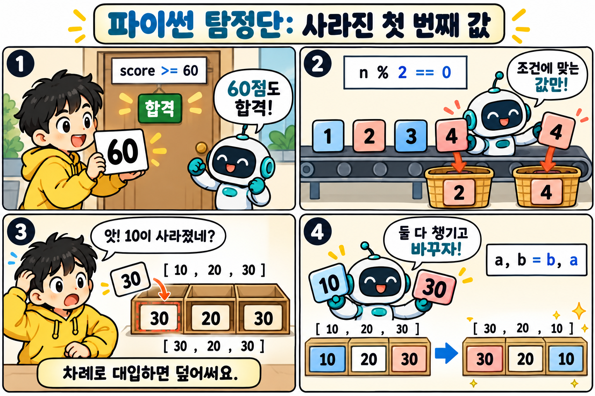

**만화 속 핵심:** 60점은 `>= 60`에 포함되고, `% 2 == 0`은 짝수만 고릅니다. 값을 차례로 덮어쓰면 처음 값이 사라질 수 있으므로 교환할 때는 오른쪽 값을 먼저 평가하는 `a, b = b, a`를 사용합니다. 3컷은 덮어쓰기 전후, 4컷은 올바른 교환 전후를 보여줍니다.

**한 줄 퀴즈:** `a=10`, `b=30`에서 `a=b; b=a`를 하면 두 값은 어떻게 될까요? → 둘 다 30입니다.

## 05 · Day5 — 원본 미확인 / FastAPI 보충 학습

**Day5 폴더는 없습니다.** 다음은 `05.FastAPI-uvicorn/labs/lesson01.py ~ lesson04.py`에서 확인한 보충 내용입니다. 폴더 이름의 05를 수업 날짜로 확정하지 않았습니다.

### 요청이 응답이 되기까지

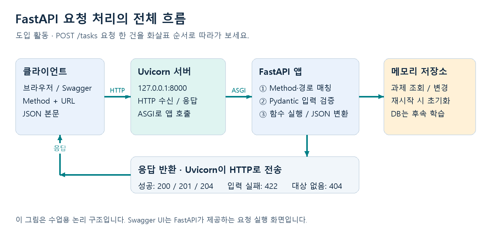

출처: 로컬 `05.FastAPI-uvicorn/assets/architecture.png`의 기존 수업 시각 자료.

Uvicorn이 서버를 실행하고 FastAPI가 메서드·경로에 맞는 함수를 찾습니다. 경로·쿼리·본문에서 입력을 받고, 처리 결과는 응답으로 전달됩니다.

```python
from fastapi import FastAPI

app = FastAPI()

@app.get("/")
def root():
    return {"message": "Hello FastAPI"}
```

`@app.get`은 모듈을 읽을 때 경로를 등록합니다. 함수 본문은 해당 요청이 들어왔을 때 실행됩니다. 해당 모듈이 `main.py`이고 그 폴더에서 실행한다면 `python -m uvicorn main:app --reload`로 개발 서버를 켭니다. `main`은 모듈, `app`은 그 안의 객체입니다. 다른 파일명이라면 명령도 달라집니다.

| 요청 | 위치·역할 | 보충 자료에서의 예 |
| --- | --- | --- |
| GET | 조회 | `/`, `/sports`, `/tasks` |
| POST | 생성·처리 | `/method`에 생성 성공 201 지정 |
| Path | 대상을 식별 | `/tasks/{task_id}` |
| Query | 검색·필터·페이지 조건 | `?q=Python&done=false&skip=0&limit=10` |

`/tasks/stats` 같은 고정 경로를 `/tasks/{task_id}`보다 먼저 선언하는 예제가 있습니다. 조회 목록은 검색·완료 필터를 적용하고 전체 개수를 계산한 뒤 `skip:skip + limit`로 일부를 가져옵니다. 루트 `/`는 각 앱에서 선언한 경우에만 존재합니다.

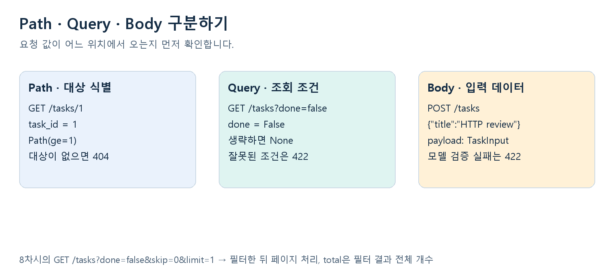

출처: 로컬 `05.FastAPI-uvicorn/assets/parameters.png`.

**직접 해보기:** `/items/3?qty=2`에서 Path 값과 Query 값을 각각 찾아보세요. Swagger의 `/docs`와 기계가 읽는 `/openapi.json`이 하는 일은 어떻게 다를까요?

## 06 · Day6 — Pydantic으로 데이터 검증

### 모델은 데이터의 규칙을 선언한다

일반 클래스의 `age: int`는 주로 설명과 정적 분석을 위한 힌트입니다. Pydantic의 BaseModel은 인스턴스를 만들거나 model_validate를 호출할 때 실제 데이터를 검사합니다.

```python
from pydantic import BaseModel, ConfigDict, Field

class Product(BaseModel):
    model_config = ConfigDict(extra="forbid")
    title: str = Field(min_length=2, max_length=60)
    price: int = Field(gt=0, strict=True)
    stock: int = Field(default=0, ge=0)
    sku: str = Field(pattern=r"^SKU-[0-9]{4}$")
```

위는 원본 실습의 TODO 조건에 맞춘 **교정 예제**입니다. 원본 `exercise.py`는 ‘가격 0보다 큼’이라는 주석과 달리 `ge=0`이라 0을 허용하고, product·ValidationError·main 정의도 빠져 있어 그대로 실행할 완성본으로 보면 안 됩니다.

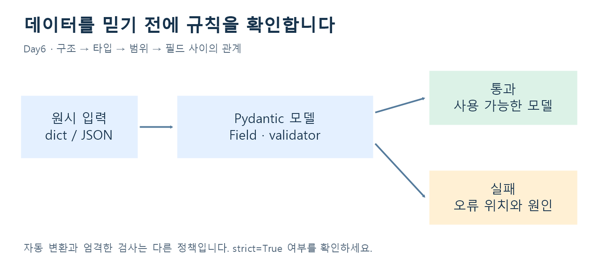

| 선언 | 의미 | 예 |
| --- | --- | --- |
| `age: int` | 필수 필드 | 일반 설정에서는 `"34"`를 34로 변환 가능 |
| `nickname: str \| None = None` | 생략·None 허용 | 선택 별명 |
| `value: int \| str` | 여러 타입 허용 | 정수·문자열 학번 |
| `gt=0` / `ge=0` | 0 초과 / 0 이상 | 가격 / 재고 |
| `strict=True` | 자동 변환을 제한 | 엄격한 정수 입력 |
| `extra="forbid"` | 정의하지 않은 필드 거절 | 오타 필드 발견 |
| `model_dump()` | 모델을 dict로 변환 | 출력·후속 처리 |

None을 허용하는 타입과 생략 가능한 필드는 같은 뜻이 아닙니다. `nickname: str | None`만 선언하면 값은 None일 수 있어도 필드는 여전히 필수이며, 생략까지 허용하려면 기본값을 지정해야 합니다.

### 필드·모델·중첩 검증

`field_validator`는 아이디 공백·소문자 정리나 태그 문자열 분해처럼 한 필드에 규칙을 둡니다. `mode="before"`는 타입 검증 이전의 입력을 다룰 수 있습니다. `model_validator(mode="after")`는 비밀번호 확인 일치, 예약 시작·종료일 순서처럼 여러 필드의 관계를 검사합니다.

원본 Reservation의 조건 `start > end`는 **종료일이 시작일보다 이르면 거절**한다는 뜻입니다. 원본 오류 메시지는 이 관계를 반대로 표현하므로 조건식을 기준으로 읽어야 합니다. 시작일과 종료일이 같은 경우는 이 조건에서 허용됩니다.

중첩 모델에서는 Order 안에 Address, `list[OrderItem]`, 배송 방식 Enum을 넣습니다. `ValidationError.errors()`의 loc는 예를 들어 `('items', 0, 'quantity')`처럼 잘못된 위치를 알려 줍니다.

**직접 해보기:** 가격 0, 재고 -1, SKU-001은 위 교정 모델에서 통과하나요? `"20"`과 20의 차이를 strict=True 적용 전후로 설명해 보세요.

### 🎬 쉬어가는 만화 2 — Pydantic 공항

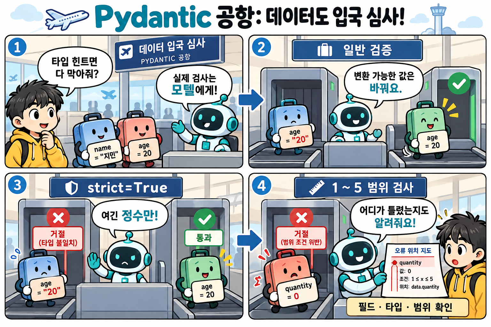

**만화 속 핵심:** 일반 클래스의 타입 힌트만으로 입력을 막지는 않습니다. Pydantic은 모델 생성 시 검증하며, 일반 정수 필드는 문자열 `"20"`을 20으로 변환할 수 있습니다. `int` 필드에 `strict=True`를 적용하면 문자열 `"20"`은 거절합니다. 범위 검사에서 수량 0은 1~5에 들어가지 않습니다. 만화의 ‘오류 위치 지도’는 설명용 표현이며 실제 오류 위치는 `ValidationError.errors()`의 `loc`에서 확인합니다.

**한 줄 퀴즈:** `price: int = Field(gt=0, strict=True)`에 `"100"`을 넣으면? → 문자열이므로 거절합니다.

## 07 · Day7 — 기다림을 겹치는 비동기 처리

### async는 어디서 기다리느냐가 중요하다

`async def`만 붙여도 모든 처리가 빨라지지는 않습니다. 이벤트 루프 안에서 `time.sleep(2)`를 직접 호출하면 다른 작업도 기다립니다. `await asyncio.sleep(2)`는 기다리는 동안 다른 작업이 진행될 기회를 줍니다. 기존 동기 I/O 함수를 유지해야 한다면 수업 예제처럼 `await asyncio.to_thread(...)`로 별도 스레드에 맡길 수 있습니다.

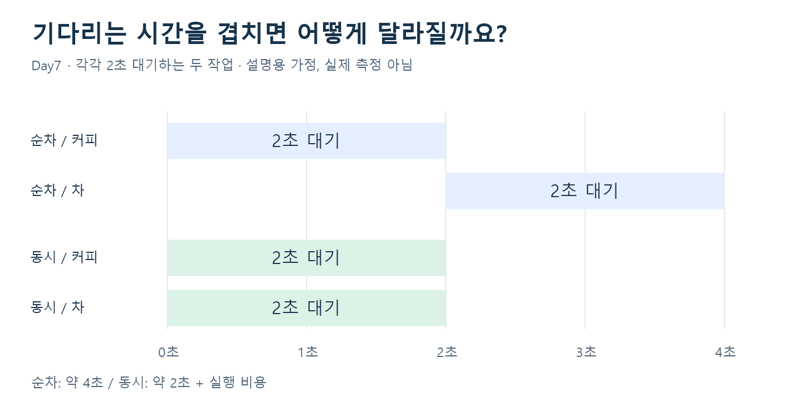

이 그림은 각각 2초씩 기다리는 두 작업의 **이론적 비교**이며 이번 작업의 실제 측정 결과가 아닙니다. 실제 시간에는 실행 비용·네트워크·서버 제한 등이 더해집니다. 동시성은 여러 I/O 대기를 겹치는 개념이며 CPU 계산의 병렬 실행을 자동 보장하지 않습니다.

```python
import asyncio

async def make_drink(name):
    await asyncio.sleep(2)
    return name

async def main():
    drinks = await asyncio.gather(
        make_drink("커피"), make_drink("차")
    )
    print(drinks)

asyncio.run(main())
```

### 외부 API를 읽을 때의 확인 순서

1. 연결과 타임아웃을 확인합니다.
2. `response.raise_for_status()`로 실패 HTTP 상태를 확인합니다.
3. JSON 변환이 가능한지 확인합니다.
4. dict·필수 키·필드 타입 등 업무에 필요한 응답 구조를 검증합니다.
5. 요청 ID와 응답을 함께 보관해 완료 순서가 바뀌어도 연결을 유지합니다.

**원본에서 찾은 점검 포인트**

- `Day7/02/main.py`의 `'f/todos/{todo_id}'`는 f-string이 아닙니다. 의도한 주소는 `f'/todos/{todo_id}'`입니다. `raise_for_status()`가 빠져 HTTPStatusError 처리도 기대대로 작동하지 않으며 실패 후 data가 정의되지 않는 경로도 주의해야 합니다.
- `Day7/03/main.py`는 as_completed로 완료된 순서대로 결과를 모은 뒤 원래 ID와 zip합니다. 응답이 2→3→1 순서로 끝나면 요청 ID가 잘못 연결될 수 있습니다. 작업이 `(item_id, data)`를 함께 반환하도록 바꾸면 관계를 보존할 수 있습니다.
- gather는 결과를 전달한 작업의 순서로 모으며, as_completed는 완료 순서로 처리합니다. 실패 전파·취소 정책은 별도로 설계해야 합니다.
- mock_api.py는 지연·404·503·깨진 JSON·필드 누락·429·재시도를 실험할 자료입니다. 파일에 시나리오가 있다고 해서 모든 방어 로직이 구현되어 있다는 뜻은 아닙니다.

**체험 자료:** `Day7/01/shop_concurrency`에는 blocking·async·thread 상품 조회를 비교하는 화면이 있습니다. 실행 경로는 실제 폴더를 기준으로 사용하세요. README에 있는 일부 예시 경로에는 `01`이 빠져 있습니다.

**직접 해보기:** 0.6초·0.1초·0.3초 작업을 동시에 시작하면 어떤 순서로 완료될까요? 번호를 함께 반환해야 하는 이유를 설명해 보세요.

## 08 · Day8 — 동작을 확인하는 API 테스트

Day8 안에는 **8개의 차시**가 있습니다. 이 차시 번호와 Day1~Day8의 날짜 구분을 혼동하지 마세요. 기대값은 현재 코드의 결과를 복사하지 않고 README의 업무 계약과 TEST_CASES.md에서 정합니다.

| 차시 | 핵심 질문 | 실제 소스에서 확인한 사항 | 검증할 결과 |
| --- | --- | --- | --- |
| 1 Swagger·OpenAPI | 호출되는 경로가 문서에도 있는가? | 현재 main은 include_in_schema=True | /greet 호출과 OpenAPI paths 모두 확인 |
| 2 Path·Query | 생략·끝값에서도 맞는가? | 현재 qty 기본값 1, 범위 1~5 | 생략·1·5 성공, 0·6 오류 |
| 3 요청 본문 | 타입·누락·추가 필드 정책은? | strict 정수와 extra=forbid 적용 | 정상 201, 잘못된 입력 422 |
| 4 AI 테스트 | 할인 경계를 놓치지 않았는가? | 현재 amount > 10000 | 10000 이상 1000원 할인 계약 대조 |
| 5 오류 응답 | 없는 상품이 200으로 위장되는가? | except Exception이 404를 삼킴 | 존재 200, 없음 404, 입력 오류 422 |
| 6 응답 계약 | 내부 정보가 나가는가? | ProfileOut에 internal_note 포함 | 공개 필드만 존재하고 내부 필드 부재 |
| 7 상태 시나리오 | 두 번째 생성이 첫 항목을 지우는가? | task_id를 항상 1로 사용 | 서로 다른 ID와 두 데이터 보존 |
| 8 종합 검증 | 실패 뒤 상태도 안전한가? | 좌석을 먼저 차감한 뒤 부족 검사 | 거절 후 남은 좌석·기존 예약 보존 |

**현재 코드와 과거 기록 구분:** 차시 1~3의 README·VERIFICATION에는 제작 당시 의도한 결함이 설명되어 있지만 현재 main.py는 이미 교정된 부분이 있습니다. 그 기록을 현재 실행 결과로 인용하지 않았습니다. 이번 정리에서는 코드를 읽어 분석했으며 전체 테스트를 새로 실행했다고 주장하지 않습니다.

### 문서와 실행 결과를 구분하기

Swagger UI의 Example Value는 예시입니다. Try it out → Execute 후 **Server response**가 실제 결과입니다. OpenAPI는 기계가 읽는 명세이며 문서가 생성되었다는 사실만으로 업무 규칙이 맞는지는 알 수 없습니다.

### 경계값: 10000원 할인

| 입력 금액 | 계약상 할인 | 계약상 결제액 | 현재 `> 10000` 코드 |
| --- | --- | --- | --- |
| 9999 | 0 | 9999 | 계약과 일치 |
| 10000 | 1000 | 9000 | 할인 0으로 불일치 |
| 10001 | 1000 | 9001 | 계약과 일치 |

교정 방향은 조건을 `amount >= 10000`으로 바꾸는 것입니다. 테스트 기대값을 잘못된 구현에 맞춰 바꾸면 결함을 놓칩니다.

```python
import pytest
from fastapi.testclient import TestClient
from main import app

client = TestClient(app)

@pytest.mark.parametrize("amount, payable", [
    (9999, 9999), (10000, 9000), (10001, 9001)
])
def test_discount_boundary(amount, payable):
    response = client.post("/quotes", json={"amount": amount})
    assert response.status_code == 200
    assert response.json()["payable"] == payable
```

이 예제는 lesson_04 폴더의 main을 대상으로 하는 설명용 검사입니다. 원본이 수정되지 않았다면 가운데 입력에서 실패할 것으로 코드상 예상됩니다.

### 실패 응답 뒤에도 상태가 맞아야 한다

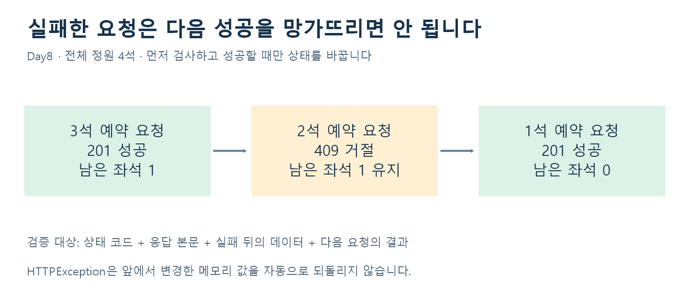

정원 4석에서 3석 예약 성공 → 2석 추가 예약 거절 → 1석 예약 성공이 되어야 합니다. 기대 상태는 201 → 409 → 201이며 잔여 좌석은 1 → 1 → 0입니다. 거절 전에 좌석을 빼면 실패가 다음 요청까지 망가뜨립니다. `raise HTTPException`은 앞서 변경한 메모리 상태를 자동으로 되돌리지 않습니다.

```python
# 교정 원리: 먼저 확인하고 성공할 때만 변경합니다.
if body.seats > app.state.remaining:
    raise HTTPException(status_code=409, detail="Not enough seats")
app.state.remaining -= body.seats
```

이 간단한 메모리 예제는 단일 프로세스 학습용입니다. 운영 환경의 동시 예약·여러 worker·영속성까지 보장하는 구현으로 확대 해석하지 않습니다.

### 테스트 실행과 기록

차시별 main 모듈 이름이 같으므로 각 lesson 폴더 안에서 `python -m pytest -q test_api.py`로 실행합니다. TestClient는 프로세스 안에서 app을 호출하므로 별도 Uvicorn 서버가 필요하지 않습니다. Swagger로 실행하는 서버의 메모리와 테스트의 메모리는 별개입니다. fixture로 테스트 간 공유 상태를 초기화하면 실행 순서에 따른 간섭을 줄일 수 있습니다.

좋은 검증 보고서에는 입력, 계약상 기대값, 실제 상태·본문, 수정 전 실패, 수정 이유, 수정 후 회귀 결과, 미검증 범위를 함께 적습니다. AI가 만든 테스트도 정상·경계·오류·필드 부재·상태 변화의 누락을 검토해야 합니다.

### 🎬 쉬어가는 만화 3 — 카페 API의 하루

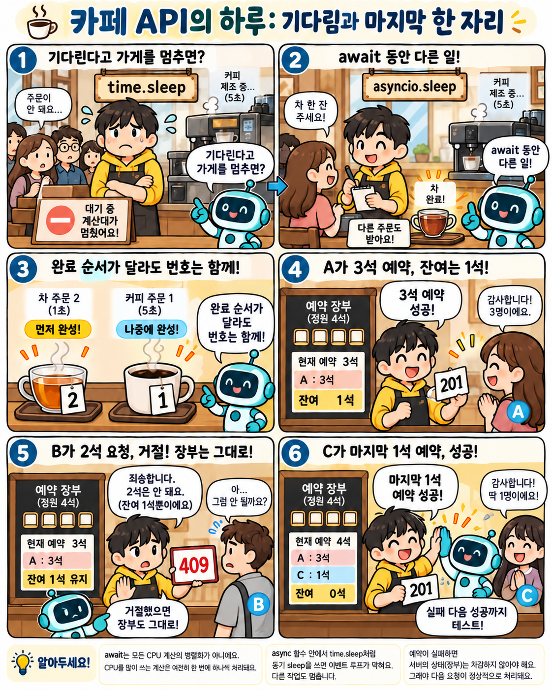

**앞의 세 컷:** 이벤트 루프에서 동기 `time.sleep`을 직접 실행하면 다른 작업도 막힙니다. 비동기 대기 중에는 다른 작업이 진행할 수 있고, 먼저 끝난 결과라도 원래 요청 번호와 함께 보관해야 합니다. 만화의 1초·5초는 설명용 대기 시간이며 실제 측정값이 아닙니다.

**뒤의 세 컷:** 정원 4석에서 A의 3석 예약 후 잔여 1석 → B의 2석 요청 거절 후에도 잔여 1석 → C의 마지막 1석 예약 후 잔여 0석입니다. 기대 상태는 **201 → 409 → 201**입니다. 실패 응답뿐 아니라 장부와 다음 정상 요청까지 확인하는 것이 핵심입니다.

**한 줄 퀴즈:** 409를 반환하면 앞에서 변경한 메모리도 자동으로 되돌아갈까요? → 아닙니다. 먼저 검사하고 성공할 때만 상태를 변경해야 합니다.

## 09 · Day9 — CRUD를 완성하고 변경을 함께 검토하기

**자료:** `Day9/kdt_crud_pr_ai_review/lesson_01 ~ lesson_08`. 앞의 네 차시는 Task API, 뒤의 네 차시는 Git·PR·리뷰·병합과 이를 설명하는 작은 Python 함수입니다. 뒤의 함수 검사는 실제 GitHub PR 생성·리뷰 완료를 뜻하지 않습니다.

### CRUD는 요청 하나보다 데이터의 이어지는 변화가 중요하다

| 작업 | 수업의 HTTP 예 | 확인할 계약 |
| --- | --- | --- |
| Create 생성 | POST /tasks | 새 ID 발급과 201 |
| Read 조회 | GET /tasks, GET /tasks/{task_id} | 저장 데이터 조회, 없는 대상 404 |
| Update 교체 | PUT /tasks/1 | 이 수업에서는 제목·완료 상태를 함께 전달 |
| Update 부분 수정 | PATCH /tasks/1 | 보내지 않은 필드는 보존 |
| Delete 삭제 | DELETE /tasks/{task_id} | ID가 일치하는 데이터 삭제, 성공 204 |

**ID와 위치는 다릅니다.** ID가 1·3인 목록의 길이는 2이므로 `len(tasks)+1`은 이미 존재하는 ID 3을 만듭니다. 또한 `tasks.pop(task_id)`는 ID를 찾는 것이 아니라 그 번호의 인덱스를 삭제합니다.

학습용 ID 생성은 `max((task["id"] for task in tasks), default=0) + 1`처럼 현재 ID에서 계산할 수 있습니다. 운영 환경의 동시 생성까지 안전하게 보장하는 방식은 아니며, DB 기본키 발급과는 구분합니다. 원본 lesson_04의 생성 함수는 빈 목록에서 `max()`를 호출하므로 전체 삭제 뒤 다시 등록하는 경우도 점검할 만합니다.

### PATCH에서 생략과 값 전달을 구분하기

```python
# 설명용 교정: 요청에 실제 포함된 필드만 반영합니다.
changes = payload.model_dump(exclude_unset=True)
item.update(changes)
```

원본 lesson_03은 `model_dump()`로 모든 기본값을 내보내므로 제목만 수정해도 `done=True`가 기본값 False로 바뀔 수 있습니다. `exclude_unset=True`는 생략한 필드를 제외합니다. 사용자가 명시적으로 보낸 null까지 무조건 제외하는 옵션은 아니므로 null 허용 정책은 별도로 정해야 합니다.

### 8차시 한눈에 보기

| 차시 | 주제 | 현재 소스에서 확인한 점 |
| --- | --- | --- |
| 1 | 조회·등록 통합 | 목록 길이로 다음 ID를 계산해 중복 가능 |
| 2 | 개별 조회·404 | 현재 main은 이미 None 검사 후 404 처리. README의 미수정 예와 구분 |
| 3 | PUT·PATCH | PATCH가 전달하지 않은 기본값까지 덮어씀 |
| 4 | DELETE·전체 흐름 | ID를 인덱스로 사용해 삭제함 |
| 5 | 기능 브랜치·커밋 | `bool("false")`는 True. 문자열을 명시적으로 해석해야 함 |
| 6 | PR의 변경 범위 | 요약 함수가 삭제된 파일을 제외함 |
| 7 | AI 코드 리뷰 | `"admin" in role`은 `"not-admin"`도 허용. 정확한 일치 검사 필요 |
| 8 | 충돌 해결·통합 | feature 목록만 반환해 main 쪽 항목을 잃음 |

**협업 흐름:** 변경 전 확인 → 기능 브랜치 → 작은 수정·검사 → 커밋 → PR에 문제·수정·검증 기록 → 지적을 재현해 판단 → 충돌 해결 → 재검사 → 병합입니다. 이 문서는 수업 흐름을 정리한 것이며 실제 원격 저장소에 PR을 만들거나 병합하지 않았습니다.

AI 리뷰는 주장보다 **입력 → 실제 결과 → 기대 결과 → 원인**으로 평가합니다. ‘not-admin이 관리자로 판정된다’는 반례는 재현 가능한 지적입니다. 병합은 한쪽 파일을 선택하는 것만으로 끝나지 않으며, 양쪽 변경 의도와 같은 ID 충돌 정책을 확인해야 합니다.

**직접 해보기:** ID가 1·3인 목록에서 새 항목을 만든 뒤 ID 3을 삭제했을 때, 어떤 ID가 남아야 하나요? 제목만 PATCH한 뒤 기존 done=True는 유지되어야 할까요?

## 10 · Day10 — SQL, 트랜잭션, 관계형 데이터

**자료:** `Day10/lesson_01 ~ lesson_08`의 README·main·solution·check. 주로 Python 표준 sqlite3를 사용하는 독립 실습입니다. 각 파일이 사용하는 `autocommit` 매개변수는 Python 3.12 이상에서 제공되므로 오래된 환경에서는 같은 코드가 실행되지 않을 수 있습니다.

### 메모리에서 파일로: 조회됐다고 저장이 확정된 것은 아니다

메모리 목록은 프로세스가 끝나면 사라집니다. SQLite는 파일에 데이터를 보관하지만, 수업의 트랜잭션 설정에서는 INSERT 뒤 commit해야 변경을 확정합니다. 같은 연결에서 조회된 행이 재연결 뒤에도 남는지 확인해야 합니다.

| SQL | 의미 | 함께 확인할 점 |
| --- | --- | --- |
| INSERT | 행 추가 | 매개변수 바인딩·commit |
| SELECT | 행 조회 | WHERE·ORDER BY·LIMIT |
| UPDATE | 행 수정 | WHERE와 변경된 행 수 |
| DELETE | 행 삭제 | ID 조건·없는 대상 정책 |
| JOIN | 관련 테이블 연결 | 연결 기준과 누락 행 |
| GROUP BY | 묶어서 집계 | COUNT의 대상과 NULL |

```sql
-- 설명용 조회: 도시 필터 → 점수순 → 동점은 ID순 → 개수 제한
SELECT id, nickname, points
FROM users
WHERE city = ?
ORDER BY points DESC, id ASC
LIMIT ?;
```

SQLite에서 `?`에 값을 바인딩하면 `O'Neil` 같은 따옴표 포함 값도 SQL 문법과 분리해 전달할 수 있습니다. PostgreSQL psycopg 예제의 자리표시자는 `%s`이므로 그대로 섞어 쓰지 않습니다. 값 바인딩은 테이블명 같은 SQL 식별자를 넣는 용도와도 다릅니다.

### 트랜잭션: 함께 성공하거나 함께 취소하기

질문 저장과 답변 저장을 한 묶음으로 취급한다면 두 INSERT 뒤에 commit하고, 중간 실패에는 rollback해야 합니다. 첫 작업 직후 commit하면 두 번째가 실패해도 이미 확정된 첫 변경은 나중의 rollback으로 돌아오지 않습니다.

**Day8과 연결:** 메모리 값을 바꾼 뒤 HTTPException을 일으키면 자동 복구되지 않았습니다. DB에서도 트랜잭션 범위와 확정 시점을 직접 맞춰야 실패 후 상태를 보존할 수 있습니다.

### 사용자 → 대화방 → 메시지 관계

**users 1 → N conversations 1 → N messages**

한 사용자는 여러 방을 만들고, 한 방에는 여러 메시지가 쌓입니다. 기본키는 행을 식별하고 외래키는 부모 행과 연결합니다. conversations.user_id에 UNIQUE를 걸면 한 사용자당 방 하나로 제한되어 수업의 1:N 요구와 충돌합니다.

| 차시 | 결함·질문 | 교정·검증 방향 |
| --- | --- | --- |
| 1 저장 확정 | INSERT 뒤 commit 누락 | 연결을 닫고 다시 읽어 저장 확인 |
| 2 조회 조건 | `limit or 2`가 0을 2로 바꿈 | 0을 의미 있는 입력으로 보존, 동점 정렬도 검사 |
| 3 수정·삭제 | 두 작업 사이 commit | 한 트랜잭션으로 묶고 실패 시 전체 보존 확인 |
| 4 제약조건 | CHECK만으로 NULL 점수를 막지 못함 | 필수값은 NOT NULL도 지정 |
| 5 ERD | user_id의 UNIQUE가 다중 방 생성 차단 | 관계 요구에 맞게 제약 수정 |
| 6 외래키 | 트랜잭션 안에서 활성화해 적용되지 않음 | 트랜잭션 시작 전 켜고 PRAGMA 결과 확인 |
| 7 LEFT JOIN | 메시지 없는 방도 COUNT(*)가 1 | 실제 메시지 키인 COUNT(m.id)로 집계 |
| 8 이력 모듈 | 저장은 소유자 확인, 조회는 방 ID만 확인 | 조회에도 사용자 ID 조건 추가 |

차시 6의 현재 main은 autocommit=False 연결에서 PRAGMA를 실행합니다. solution처럼 설정을 적용할 수 있는 시점에 활성화하고 실제 값을 확인하는 것이 중요합니다. 이 문서의 표는 소스 분석이며 새 실행 결과가 아닙니다.

### 읽기에도 소유권 검사가 필요하다

```sql
-- 설명용 교정: 요청자가 소유한 방의 메시지만 조회
SELECT m.id, m.role, m.content
FROM messages AS m
JOIN conversations AS c ON c.id = m.conversation_id
WHERE c.id = ? AND c.user_id = ?
ORDER BY m.id;
```

원본 lesson_08의 list_history는 user_id 인자를 받지만 SQL에서 사용하지 않습니다. 함수에 인자를 받았다는 사실만으로 접근 제어가 생기지 않습니다. 쓰기와 읽기에 같은 소유권 정책이 적용되는지 모두 검사해야 합니다.

**별도 결과물:** `Day10/demo`는 회원·게시판·댓글·마스킹 화면의 목업입니다. README에 따르면 계정과 게시글 상태는 브라우저 저장소 기반이며, 실제 DB 회원 인증이나 실제 비밀번호 찾기 메일 전송과는 구분해야 합니다. 해당 프로젝트의 버전 추천·배포 기록을 이번 수업 정리에서 새 검증 결과로 인용하지 않았습니다.

**직접 해보기:** 빈 방의 메시지 수가 왜 COUNT(*)로 1이 될까요? 두 작업 사이의 commit을 마지막으로 옮기면 어떤 실패를 되돌릴 수 있을까요?

### 🎬 쉬어가는 만화 4 — 데이터 탐정단

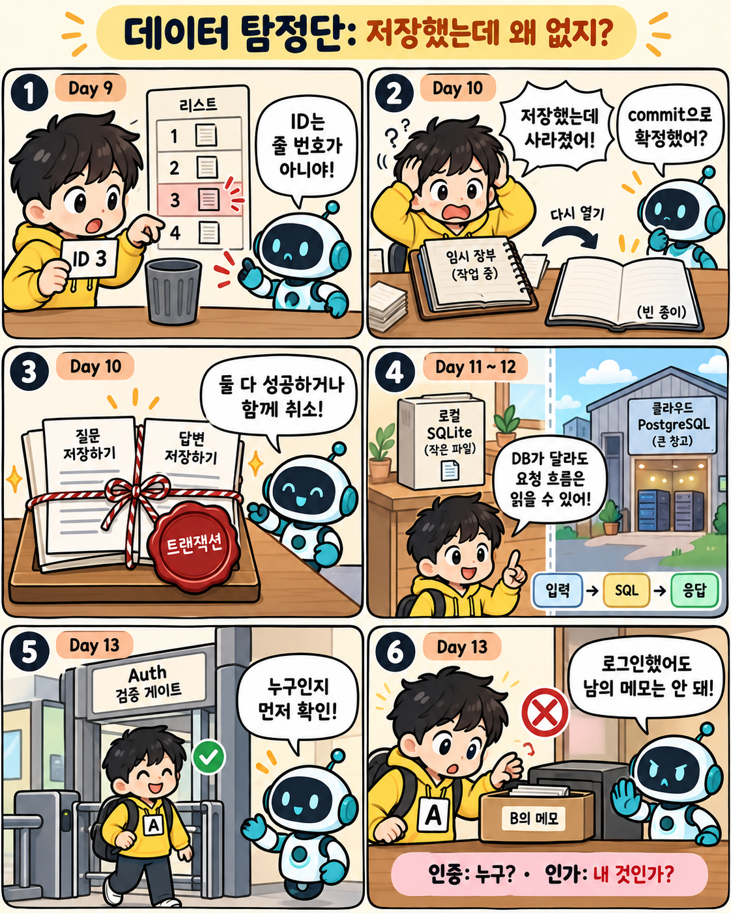

1~3컷은 Day9~10, 4컷은 Day11~12, 5~6컷은 Day13의 이야기입니다. ‘작은 파일·큰 창고’는 배치 형태를 쉽게 설명한 비유이며 DB의 기능이나 성능 우열을 단정하지 않습니다. 마지막 ‘내 것인가?’는 이번 메모 API의 인가 정책입니다. 일반적인 인가는 역할·공유 권한 등 더 다양한 정책을 포함할 수 있습니다.

## 11 · Day11 — PostgreSQL 연결과 로컬 AI 대화

### 같은 SQL 개념을 다른 저장소로 옮기기

`Day11/main.py`는 파일 위치 기준 config.json을 읽어 psycopg로 Supabase PostgreSQL에 연결하고 `current_database()`와 `current_user`를 조회합니다. **DB에 연결됐는지 확인하는 실습**이지 웹 로그인 API는 아닙니다. 실제 host·user·password·프로젝트 키 등 연결값은 이 정리에 복사하지 않았습니다.

`main2.py`는 ch2 스키마에 users를 준비한 뒤 다음을 수행합니다.

**테이블 준비 → 여러 사용자 INSERT → 전체 SELECT → 이메일 조건 UPDATE → 이메일 조건 DELETE → 재조회**

- `GENERATED ALWAYS AS IDENTITY`로 ID를 발급하고 PK로 식별합니다.
- name·email에는 NOT NULL, email에는 UNIQUE가 있습니다.
- `executemany()`는 여러 입력에 같은 SQL을 적용합니다.
- psycopg의 `%s`와 별도 튜플로 값을 전달합니다.
- 해당 코드의 `with psycopg.connect(...)`는 정상 종료 시 commit, 예외 시 rollback하고 연결도 닫는 수명을 제공합니다. sqlite3 연결의 with와 동일하다고 가정하지 마세요.

**원본 점검:** main2.py는 시작할 때 `DROP TABLE IF EXISTS ch2.users`를 실행하므로 재실행 시 기존 실습 데이터를 지우는 구조입니다. 분석만 수행했으며 실제 DB에 연결하거나 실행하지 않았습니다.

### LM Studio 실습은 별도 갈래

| 파일 | 확인한 역할 |
| --- | --- |
| lmstudio_my.py | 로컬 서버의 모델 목록을 조회하고 첫 모델 ID 확인 |
| lmstudio_my2.py | 모델 선택·입력 반복·스트리밍 출력·대화 기록·예외 처리 |

클라이언트의 base_url은 코드에서 로컬 LM Studio 서버를 가리킵니다. OpenAI Python SDK 형식으로 호출하더라도 이 예제의 요청 목적지는 로컬 서버입니다. 코드의 포트는 1235이며 실제 실행한 서버 포트와 맞아야 합니다.

**대화 흐름:** 모델 목록 → 사용자 선택 → system 메시지 → user 입력 → 조각 응답 수신 → 텍스트 합치기 → 성공한 대화 기록 반영. `/clear`는 메모리 대화를 초기화하고 `/exit`는 종료합니다. 응답이 비어 있거나 통신이 실패하면 해당 요청을 정상 대화로 기록하지 않도록 분리합니다. 메모리 메시지 목록은 Day10의 DB 대화 저장 모듈과 자동 연결되어 있지 않습니다.

### 함께 발견한 종합 프로젝트를 구분하기

| 폴더 | 자료에서 확인한 성격 | 읽을 때 주의 |
| --- | --- | --- |
| Day11-supabase | README·ANALYSIS는 단일 SQLite 방명록 설명 | 폴더 이름만으로 Supabase DB 사용을 단정하지 않음 |
| day11_1 | 회원·상품·주문·결제의 쇼핑몰 설계·구현 자료 | 수업 기본 연결 실습과 별도 종합 프로젝트 |

day11_1에는 ERD, 구매 시뮬레이션, 테이블 정의, API·배포·인증 문서가 있습니다. README는 Supabase Auth 전환과 실제 app 실행·화면 미리보기 서버를 구분하고 있습니다. 프로젝트 안에 과거 검증 문서가 존재하지만 이번 정리에서 결제·로그인·배포를 새로 수행하거나 성공을 확인한 것은 아닙니다.

**직접 해보기:** DB 비밀번호와 사용자의 로그인 비밀번호는 같은 역할일까요? 스트리밍 응답 중 실패한 답변을 정상 대화 기록처럼 저장하면 어떤 문제가 생길까요?

## 12 · Day12 — HTTP 요청을 PostgreSQL 저장으로 연결하기

**자료:** `Day12/main.py`, `lesson01.md`, `lesson01.py`, `간단쇼핑몰.txt`.

### 환경변수와 실행 설정

`lesson01.py`는 dotenv로 설정을 읽고 os.getenv로 값을 조회하는 예입니다. 원본은 password도 출력하므로 정리용 예제로 그대로 실행하거나 출력물을 공유하지 않습니다. main.py는 코드 파일 옆 .env를 읽고 필요한 연결 설정을 확인합니다. 문서에는 값 대신 설정 이름과 역할만 기록했습니다.

### 사용자 등록·조회 API의 전체 흐름

**Swagger/브라우저 → APIRouter → UserCreate 검증 → psycopg 연결 → PostgreSQL SQL → dict 행 → JSON**

| 요소 | 현재 main.py의 동작 |
| --- | --- |
| UserCreate | 이름 1~50자, 이메일 문자열 1~100자, 앞뒤 공백 제거, 추가 필드 거절 |
| initialize_database | kdt_api01 스키마와 users 테이블을 없으면 생성 |
| POST /users | INSERT 후 RETURNING으로 생성 행 반환, 성공 201 |
| GET /users | ID 오름차순으로 전체 사용자 반환 |
| dict_row | 결과를 컬럼 이름을 가진 dict 형태로 제공 |
| include_router | 관련 경로 묶음을 실제 FastAPI 앱에 등록 |

```python
# main.py의 핵심 처리 방식: 사용자 값은 SQL과 분리합니다.
row = conn.execute(
    "INSERT INTO kdt_api01.users (name, email) "
    "VALUES (%s, %s) RETURNING id, name, email",
    (user.name, user.email),
).fetchone()
```

이메일은 현재 `str`이므로 길이를 검사하지만 이메일 형식 자체는 검사하지 않습니다. 테이블에도 email UNIQUE가 없습니다. Day11의 users 테이블과 다른 스키마·규칙입니다. Day13의 EmailStr과 비교하면 모델을 왜 다르게 선언하는지 이해할 수 있습니다.

**실행 방식의 차이:** 현재 코드는 `if __name__ == "__main__"` 안에서 DB 초기화와 `app.state.db_config` 설정을 수행합니다. 이 파일을 직접 실행하는 `python main.py`와, 모듈만 가져오는 `uvicorn main:app`은 동일하지 않습니다. 후자는 해당 블록을 실행하지 않으므로 현재 구조 그대로라면 DB 설정이 준비되지 않을 수 있습니다. 교안의 실행 예를 현재 소스에 대조해야 하는 지점입니다.

`lesson01.md`에는 getpass 입력 기반 안내도 있으나, 현재 main.py는 .env 기반입니다. 문서에 적힌 방식을 현재 구현으로 단정하지 않았습니다. 또한 Supabase PostgreSQL에 psycopg로 직접 접속하는 이 경로는 Supabase의 REST Data API 호출과 다릅니다.

### 쇼핑몰 기획은 구현 목록과 구분하기

`간단쇼핑몰.txt`에는 회원·상품·주문(장바구니)·결제 테이블, 상품 선택·장바구니·구매내역·계정 수정 등의 요구가 있습니다. 비로그인 상태에서 인증이 필요한 동작을 선택하면 로그인 후 이전 화면으로 돌아오는 흐름도 포함합니다. 이 내용은 **기획 요구사항**이며 Day12/main.py에 쇼핑몰 전체가 구현되어 있다는 뜻은 아닙니다. 관련 종합 구현 자료는 별도 day11_1에서 읽습니다.

**직접 해보기:** POST /users의 결과에 생성된 ID가 있는 이유는 무엇인가요? 이메일 문자열 길이만 검사하는 것과 EmailStr 사용은 어떻게 다를까요?

## 13 · Day13 — 로그인, 토큰 검증, 내 메모 접근 제어

**자료:** `Day13/main.py`, `main2.py`, `main3.py`. 파일 안의 ‘차시’ 표시는 Day13 내부 실습 구분이며 날짜 Day 번호가 아닙니다.

| 파일 | 구현 범위 |
| --- | --- |
| main.py | POST /auth/login, POST /auth/signup |
| main2.py | 로그인 + Bearer 토큰으로 GET /me |
| main3.py | 로그인·현재 사용자 의존성 + SQLite 메모 생성·목록·개별 조회 |

### 1. 가입과 로그인은 다르다

가입은 `auth.sign_up`, 로그인은 `auth.sign_in_with_password`를 호출합니다. 로그인 모델은 EmailStr로 이메일 형식을 검사하고 비밀번호는 SecretStr로 받습니다. 로그인은 기존 비밀번호를 확인하는 일이므로 비밀번호 앞뒤 공백을 제거하거나 가입용 강도 규칙을 다시 적용하지 않습니다.

main.py의 가입 모델에는 길이 8~128의 규칙이 있습니다. 가입 응답은 안내 문구이며 이메일 확인 설정에 따라 다음 절차가 달라질 수 있습니다. 가입 안내를 받았다는 것과 즉시 로그인 가능한 세션을 받았다는 것은 구분해야 합니다.

### 2. 토큰의 역할을 구분하기

| 값 | 용도 | 혼동하지 말 것 |
| --- | --- | --- |
| 프로젝트 publishable 키 | 어떤 Supabase 프로젝트에 요청할지 연결 | 사용자 본인을 입증하는 access token과 다름 |
| access_token | 보호 API에 제시하는 사용자 JWT | 내용을 읽는 것과 진위 검증은 다름 |
| refresh_token | 새 세션 토큰을 받는 데 사용 | JWT 형태라고 가정하지 않음 |
| expires_in / expires_at | 발급 기준 기간 / 절대 만료 시각 | 서로 다른 시간 표현 |
| SecretStr | 모델 표시에서 비밀 문자열을 가림 | 암호화·해싱·자동 로그 보안이 아님 |

원본은 token 응답에 `Cache-Control: no-store`를 지정하고 422 오류에서 원본 input을 제외합니다. SDK 전체 응답 대신 API에 필요한 필드만 반환합니다. refresh_token을 응답한다고 해서 이 세 파일에 토큰 갱신 경로까지 구현되어 있는 것은 아닙니다.

### 3. HTTPBearer는 추출, get_user는 검증

```text
Authorization: Bearer <access_token>
    ↓ HTTPBearer: 헤더에서 토큰 추출
    ↓ get_current_user: 공통 의존성
    ↓ Supabase auth.get_user(token): 사용자 확인
    ↓ CurrentUser(id, email)
    ↓ 보호된 경로 실행
```

HTTPBearer는 헤더를 읽고 Swagger의 인증 입력을 연결하지만 JWT 서명·만료를 혼자 검증하지 않습니다. 현재 소스는 Auth 서버의 get_user로 사용자를 확인합니다. `Depends(get_current_user)`처럼 함수를 전달하면 FastAPI가 요청 처리 중 의존성을 실행합니다. `get_current_user()`를 등록 시점에 미리 호출하는 것과 다릅니다.

로그인 후 여러 요청에서 재사용하는 공통 사용자 확인 절차를 의존성으로 분리하면 메모 생성·조회마다 같은 인증 규칙을 적용하기 쉽습니다. 사용자별 전역 SDK 세션에 의존하지 않도록 요청용 클라이언트의 세션 저장·자동 갱신 설정도 명시되어 있습니다.

### 4. 인증과 인가: 로그인했다고 모든 메모를 읽지는 못한다

main3.py의 메모 저장소는 PostgreSQL이 아닌 **NOTES_DB로 지정한 SQLite 파일**입니다. 각 메모에는 id, owner_id, content가 있습니다.

| 경로 | 핵심 규칙 |
| --- | --- |
| POST /notes | content를 검증하고 owner_id는 확인된 user.id로 서버가 결정 |
| GET /notes | `WHERE owner_id = ?`로 내 메모만 조회 |
| GET /notes/{note_id} | `WHERE id = ? AND owner_id = ?`로 ID와 소유자 모두 확인 |

```python
# main3.py의 접근 제어 핵심
row = db.execute(
    "SELECT id, owner_id, content FROM notes "
    "WHERE id = ? AND owner_id = ?",
    (note_id, user.id),
).fetchone()
if row is None:
    raise HTTPException(404, "메모를 찾을 수 없습니다.")
```

요청 본문에 owner_id를 받아 신뢰하지 않습니다. 없는 ID와 타인 소유 ID는 같은 404로 응답해 둘을 구분하지 않는 정책입니다. UUID 메모 ID의 정렬은 생성 시간순을 뜻하지 않으므로 현재 `ORDER BY id`를 최신순 조회로 설명하지 않았습니다.

DB 의존성은 yield로 연결을 전달하고 finally에서 닫습니다. 쓰기 뒤 commit이 있으며, `check_same_thread=False`는 스레드 검사 제한을 푸는 설정입니다. 여러 쓰기를 자동으로 안전하게 만드는 장치는 아닙니다.

### 5. 무엇을 테스트해야 하나요?

| 시나리오 | 현재 코드의 정책상 확인할 결과 |
| --- | --- |
| 형식이 잘못된 이메일·빈 비밀번호·추가 필드 | 422, 오류 원문에 비밀번호가 되돌아오지 않음 |
| 잘못된 로그인 정보 | 해당 Auth 오류를 401로 분류 |
| 이메일 미확인 | 해당 Auth 오류를 403으로 분류 |
| 요청 과다·Auth 통신 실패 | 각각 429·503 처리 |
| Bearer 누락·유효하지 않은 사용자 토큰 | 보호 경로 거절, 401 분류 확인 |
| A가 메모 생성 | owner_id가 본문 값이 아니라 검증된 A의 ID |
| B가 A의 메모 목록·개별 조회 시도 | 목록에서 제외, 개별 조회 404 |
| 공백뿐인 메모·2000자 초과 | 입력 검증 실패 |

이 표는 소스에서 도출한 **검증 계획**입니다. 실제 계정 가입, 로그인, 메모 생성이나 외부 DB 변경은 이번 문서 정리에서 수행하지 않았습니다. main.py에는 같은 RequestValidationError 처리기가 두 번 등록되어 후자의 등록이 사용되는 중복도 있으며, 현재 두 함수의 취지는 동일합니다.

**직접 해보기:** A의 유효한 토큰으로 B의 note_id를 요청하면 왜 200이 아니어야 할까요? HTTPBearer와 auth.get_user가 각각 맡는 일을 구분해 보세요.

## 🧩 종합 연결 — 작은 방명록

`Day1-Day8`은 원본 날짜별 수업 폴더와 구분되는 결과물입니다. README·ANALYSIS에서 Python 조건·반복, Pydantic 입력 검증, FastAPI 라우트, SQLite 저장과 HTML 응답을 연결한 사례를 확인할 수 있습니다.

**폼 입력 → 길이·형식 검사 → Pydantic 검증 → SQLite 저장 → 303 이동 → 목록 HTML**

글 전체 최대 1000개, 한 페이지 20개, 작성자 1~20자·내용 1~1000자 등의 정책은 이 방명록의 규칙입니다. 모든 수업에 공통인 규칙은 아닙니다. SQL 매개변수와 HTML escape는 각각 저장 단계와 화면 출력 단계의 문제를 다룹니다.

## ✅ 복습 답안과 체크리스트

| 질문 | 확인할 답 |
| --- | --- |
| Day1: 59·60·61 | 불합격·합격·합격. 짝수 2·4의 합 6, 개수 2 |
| Day2: 20·15·60 | 변환: 성인·미성년·성인 / 필터: 20·60 |
| Day3: 잘못된 점수 | 변환 불가·범위 초과·bool·필수 키 누락. 행을 제외하면 길이는 달라질 수 있음 |
| Day4: [3,7,9] | 원본 [9,7,9] / 교환 [9,7,3] |
| 보충 FastAPI: /items/3?qty=2 | Path는 3, Query는 qty=2 |
| Day6: 가격·재고·SKU | 교정 예제에서 0·-1·SKU-001은 각각 거절 |
| Day7: 완료 순서 | 같은 시각에 시작했다는 가정에서 0.1 → 0.3 → 0.6초 |
| Day8: 예약 후 잔여 | 1 → 1 → 0. 실패가 상태를 바꾸면 안 됨 |
| Day9: ID 1·3에 새 항목 등록 후 3 삭제 | 학습용 최대 ID + 1 규칙이라면 1·4. 제목 PATCH 뒤 done=True 보존 |
| Day10: 빈 방의 집계 | LEFT JOIN의 빈 쪽도 결과 행은 있어 COUNT(*)는 1, COUNT(m.id)는 0 |
| Day11: DB와 사용자 비밀번호 | DB 연결 계정과 애플리케이션 사용자의 인증은 다른 역할 |
| Day12: 생성 ID 반환 | INSERT RETURNING으로 DB가 발급한 ID를 포함한 행을 가져옴 |
| Day13: A가 B의 메모 요청 | 인증 성공만으로 접근 불가. 현재 정책은 소유자 조건 불일치 시 404 |

- [ ] 변수·조건·반복으로 작은 문제를 해결할 수 있다.
- [ ] 필터링과 값 변환의 차이를 설명할 수 있다.
- [ ] 객체의 상태와 메서드를 구분할 수 있다.
- [ ] 예외를 원인에 따라 분리하고, 메시지로 오류를 숨기지 않는다.
- [ ] 일반 타입 힌트와 Pydantic 실행 검증을 구분할 수 있다.
- [ ] Path·Query·Body의 위치와 검증을 설명할 수 있다.
- [ ] blocking·async·thread의 대기 방식을 설명할 수 있다.
- [ ] 정상·경계·오류·상태 변화에서 기대값을 먼저 정할 수 있다.
- [ ] 현재 소스와 과거 검증 기록을 구분할 수 있다.
- [ ] ID와 리스트 인덱스, PUT과 PATCH를 구분할 수 있다.
- [ ] PR의 변경 범위에 삭제 파일과 회귀 근거도 포함할 수 있다.
- [ ] commit·rollback 시점과 트랜잭션 범위를 설명할 수 있다.
- [ ] 1:N 관계와 PK·FK·NOT NULL·UNIQUE의 역할을 설명할 수 있다.
- [ ] LEFT JOIN 결과에서 COUNT(*)와 COUNT(자식 ID)를 구분할 수 있다.
- [ ] HTTP 요청이 SQL·DB·JSON 응답으로 이어지는 경로를 설명할 수 있다.
- [ ] 토큰 추출·사용자 검증·소유자 접근 제어를 구분할 수 있다.

## 📚 원본 위치와 공식 참고 자료

로컬 원본 기준 경로는 `C:\Users\Playdata\dev`입니다. Notion에서 로컬 경로가 웹 링크처럼 열리지는 않으므로 아래 경로는 파일을 찾기 위한 표기입니다.

- Day1: `Day1/day1-1.py ~ day1-5.py`
- Day2: `Day2/오전/day2-1.py ~ day2-8.py`, `Day2/오후/day2-1.py ~ day2-4.py`
- Day3 객체: `Day3/오전/day3-1.py ~ day3-4-1.py`
- Day3 예외·리팩터링: `Day3/오후/day3-1.py ~ day3-4*.py`
- Day4: `Day4/day4-1`
- FastAPI 보충: `05.FastAPI-uvicorn/labs/lesson01.py ~ lesson04.py`, `fastapi_win_vscode/labs`
- Day6: `Day6/basemodel`, `Day6/ch04_validator/demo.py`, `Day6/ch05_nested`
- Day7: `Day7/01`, `Day7/02`, `Day7/03`
- Day8: 각 lesson의 `README.md`, `main.py`, `solution.py`, `TEST_CASES.md`, `test_api.py`, `VERIFICATION.md`
- 종합 사례: `Day1-Day8/README.md`, `Day1-Day8/ANALYSIS.md`
- Day9: `Day9/kdt_crud_pr_ai_review/lesson_01 ~ lesson_08`의 README·main·check·solution
- Day10: `Day10/lesson_01 ~ lesson_08`의 README·main·solution, 별도 목업 `Day10/demo/README.md`
- Day11 DB: `Day11/main.py`, `Day11/main2.py`
- Day11 로컬 AI: `Day11/lmstudio_my.py`, `Day11/lmstudio_my2.py`
- 관련 결과물 구분: `Day11-supabase/README.md`, `ANALYSIS.md`, `day11_1/README.md`
- Day12: `Day12/main.py`, `lesson01.md`, `lesson01.py`, `간단쇼핑몰.txt`
- Day13: `Day13/main.py`, `main2.py`, `main3.py`

아래 공식 자료는 개념을 재확인하거나 심화할 때 사용합니다. 로컬 requirements의 수업 버전과 웹 최신 문서의 버전은 다를 수 있습니다.

- [Python — 클래스](https://docs.python.org/3/tutorial/classes.html): 데이터와 동작을 묶는 객체의 기본 개념.
- [Python — 코루틴과 태스크](https://docs.python.org/3/library/asyncio-task.html): async/await·gather·as_completed·to_thread의 세부 동작.
- [Pydantic — Validators](https://docs.pydantic.dev/latest/concepts/validators/): 필드·모델 검증과 실행 순서.
- [FastAPI — Query Parameters](https://fastapi.tiangolo.com/tutorial/query-params/): 쿼리 입력·기본값·필수 여부.
- [FastAPI — Request Body](https://fastapi.tiangolo.com/tutorial/body/): 모델 기반 JSON 본문 처리.
- [FastAPI — Response Model](https://fastapi.tiangolo.com/tutorial/response-model/): 응답 검증·문서화·필드 제한.
- [FastAPI — Handling Errors](https://fastapi.tiangolo.com/tutorial/handling-errors/): HTTPException과 오류 응답.
- [FastAPI — Testing](https://fastapi.tiangolo.com/tutorial/testing/): TestClient와 pytest의 기본 사용.
- [Python — sqlite3](https://docs.python.org/3/library/sqlite3.html): 연결·SQL 매개변수·트랜잭션 제어. Day10의 autocommit 설정과 함께 확인.
- [psycopg — Transactions management](https://www.psycopg.org/psycopg3/docs/basic/transactions.html): PostgreSQL 연결의 commit·rollback과 컨텍스트 관리.
- [Supabase — Retrieve a user](https://supabase.com/docs/reference/python/auth-getuser): Auth 서버를 통해 토큰에 해당하는 사용자 확인.
- [Supabase — JWT](https://supabase.com/docs/guides/auth/jwts): 토큰의 역할과 검증 개념.

**시각 자료 출처:** 직접 제작한 도식 6개, 내장 이미지 생성 도구로 제작한 아키텍처 2장과 카툰 시트 4장, 기존 로컬 교안 이미지 2개로 총 14개입니다. 카툰은 총 20컷이며 생성 프롬프트는 함께 저장한 `이미지_생성기록.json`에 있습니다. 동시성 시간은 설명용 가정이며 실제 측정 데이터가 아닙니다. 기존 이미지는 수업 자료에서 가져온 것으로 원저작자·외부 재배포 권한은 별도로 확인하지 않았습니다.

**2026-10-30 확장 작업의 확인 범위:** Day9~13의 교안·현재 소스와 관련 프로젝트 README를 읽어 설명을 추가했습니다. 원본 수업 코드는 수정하지 않았고, 데이터베이스·Auth·LM Studio에 실제 요청을 보내지 않았습니다. 과거 VERIFICATION 기록과 이번 소스 분석, 앞으로 실행할 검증 계획을 구분했습니다.
