# 수업내용정리

> Python 기초에서 FastAPI 검증까지 · Day1–Day8 학습 노트  
> 분석 기준: 로컬 수업 소스와 교안 · 2026-10-23

## 🗺️ 전체 아키텍처 — 코드가 서비스가 되는 여행

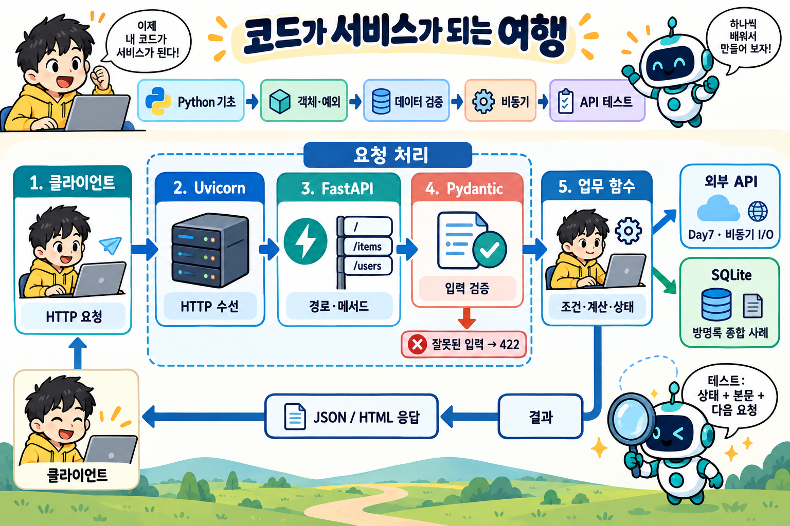

**읽는 순서:** 클라이언트의 HTTP 요청 → Uvicorn 수신 → FastAPI의 경로·메서드 선택 → Pydantic 입력 검증 → 업무 함수 → 응답입니다. 업무 함수는 필요에 따라 외부 API를 기다리거나 SQLite를 사용합니다. 이 두 가지는 선택적인 연결이며 모든 요청에서 연달아 실행되는 단계가 아닙니다.

그림은 역할을 나눈 개념도입니다. 입력 검증과 업무 함수 호출은 FastAPI의 요청 처리 안에서 이어집니다. SQLite는 별도 `Day1-Day8` 방명록 종합 사례, 외부 API와 비동기 I/O는 Day7에 해당합니다. FastAPI의 기본 입력 검증에 실패하면 422 응답을 보내며, 모든 종류의 오류가 422인 것은 아닙니다.

## 🧭 이 자료를 읽는 방법

**입력받기 → 조건으로 판단하기 → 데이터를 구조화하기 → 검증하기 → API로 제공하기 → 테스트로 확인하기**의 흐름으로 복습합니다. 각 일자의 ‘직접 해보기’를 먼저 풀고 마지막의 답과 비교하세요.

이 문서는 원본 코드를 바탕으로 새로 작성한 해설입니다. ‘교정 예제’는 원본을 수정한 파일이 아니라 이해를 돕기 위한 예제입니다. 원본에는 학생 실습, 의도한 결함, 수정본, 정답이 섞여 있습니다.

| 구간 | 확인한 자료 | 학습의 중심 | 완료하면 할 수 있는 일 |
| --- | --- | --- | --- |
| Day1 | Day1/day1-1.py ~ day1-5.py | 변수·입력·조건·반복 | 숫자 게임과 짝수 필터 작성 |
| Day2 | Day2/오전, Day2/오후 | 논리·자료구조·컴프리헨션 | 권한 판별과 목록 가공 |
| Day3 | Day3/오전, Day3/오후 | 객체·예외·리팩터링 | 상태를 관리하고 잘못된 입력 처리 |
| Day4 | Day4/day4-1 | 인덱스·대입·교환 | 값이 덮어써지는 과정 설명 |
| Day5 | 해당 이름의 폴더 없음 | 수업 원본 미확인 | 아래 보충 FastAPI 자료로 연결 |
| Day6 | Day6/basemodel, ch04_validator, ch05_nested | Pydantic 모델·검증 | 입력 규칙을 선언하고 오류 위치 확인 |
| Day7 | Day7/01 ~ 03 | 비동기·HTTP·동시성 | 대기 시간을 겹치고 외부 응답 검사 |
| Day8 | Day8/lesson_01 ~ lesson_08 | 명세·입력·응답·상태 테스트 | 계약에서 기대값을 도출하고 회귀 검사 |

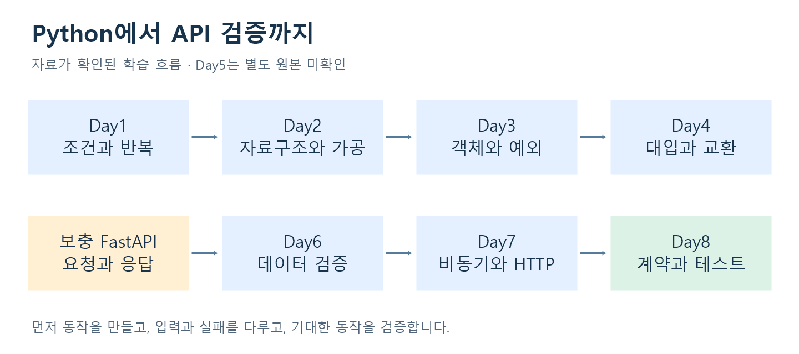

**범위 메모:** Day4는 확인한 코드가 짧아 다른 날짜와 같은 분량으로 확대하지 않았습니다. `05.FastAPI-uvicorn`과 `fastapi_win_vscode`는 FastAPI 보충 자료로 활용하며 Day5라고 단정하지 않습니다. `Day1-Day8` 방명록은 별도 종합 결과물로 다룹니다. `Day4/login.txt`의 내용은 정리에 포함하지 않았습니다.

## 01 · Day1 — 프로그램의 기본 흐름

### 핵심 개념

- **변수와 연산:** `number1 = 100`처럼 값을 이름에 연결하고 `+`, `*`, `%`로 계산합니다.
- **입력과 변환:** `input()`은 문자열을 반환합니다. 숫자 계산에는 `int()` 같은 변환이 필요하며 잘못된 입력은 예외가 될 수 있습니다.
- **조건:** 점수 60 이상이면 합격처럼 기준을 `if/else`로 표현합니다. `>=`는 경계값을 포함합니다.
- **반복:** 횟수가 정해지면 `for`, 조건을 만족할 때까지 반복하면 `while`을 사용합니다. `break`는 현재 반복문을 끝냅니다.
- **중첩 반복:** 구구단에서 바깥 반복은 단, 안쪽 반복은 곱하는 수를 바꿉니다. `range(2, 10)`에는 10이 포함되지 않습니다.

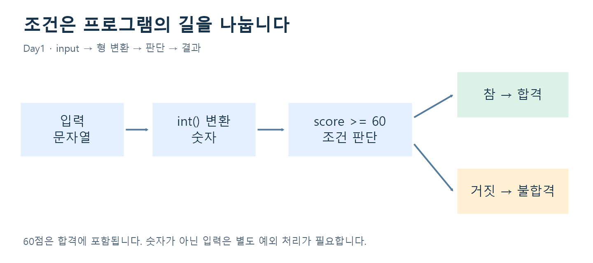

### 대표 실습: 숫자 다섯 개 중 짝수 찾기

원본 `Day1/day1-3.py`의 흐름을 간결하게 정리한 예제입니다.

```python
scores = []
for i in range(5):
    scores.append(int(input(f"{i + 1}번째 숫자: ")))

for score in scores:
    if score % 2 == 0:
        print(score)
```

`% 2`의 결과가 0이면 짝수입니다. 입력과 필터링을 나누면 각 단계의 역할을 확인하기 쉽습니다. 이 예제는 숫자가 아닌 입력의 예외 처리를 생략했습니다. 그 내용은 Day3에서 연결합니다.

### 숫자 맞추기에서 볼 점

`random.randint(1, 100)`은 양 끝을 포함한 정수를 만듭니다. 정답보다 큰지·작은지 비교하고, 정답이면 반복을 끝냅니다. 시도 횟수는 입력을 받을 때마다 증가시킵니다.

**원본 점검:** `day1-5.py`의 `print("정답입니다! 총 시도횟수는 : {count}")`는 앞에 `f`가 없어 `{count}`가 문자 그대로 출력됩니다. 교정하면 `print(f"정답입니다! 총 시도횟수는 : {count}")`입니다. 같은 파일에 게임 두 버전이 있어 첫 게임이 끝나도 다음 입력이 이어질 수 있습니다.

**직접 해보기:** 59·60·61을 입력하면 각각 합격인가요? `[1, 2, 3, 4, 5]`에서 짝수의 합과 개수를 계산해 보세요.

## 02 · Day2 — 판단 규칙과 데이터 가공

### 조건을 조립하는 법

| 표현 | 뜻 | 수업 예시 |
| --- | --- | --- |
| `A and B` | 두 조건이 모두 참 | 활성 계정이고 인증 완료 |
| `A or B` | 하나 이상이 참 | 관리자 또는 매니저 |
| `not A` | 조건의 반대 | 정지되지 않은 계정 |
| `x in values` | 목록 등에 포함 | 허용된 역할인지 확인 |
| `a if 조건 else b` | 조건에 따라 값 선택 | 합격·불합격 문자열 |

**단락 평가:** `and`는 앞이 거짓이면 뒤를 평가하지 않습니다. `user_profile is not None and user_profile.get("is_verified")`처럼 작성하면 None에 메서드를 호출하는 일을 피할 수 있습니다. 원본 `Day2/오전/day2-2.py`의 `use_profile`은 `user_profile`과 이름이 달라 실행 시 오류가 발생합니다.

### 자료구조를 선택하는 기준

| 자료구조 | 용도 | 주의할 점 |
| --- | --- | --- |
| list | 순서 있는 값들, 추가·수정 | 순회 중 원본을 삭제하면 항목을 건너뛸 수 있음 |
| dict | 이름과 값의 연결 | 없는 키를 `[]`로 읽으면 KeyError |
| tuple | 위치가 정해진 값의 묶음 | 요소 자체를 다시 대입할 수 없음 |
| set | 중복 제거·포함 검사 | 입력 순서를 보장하는 용도로 쓰지 않음 |

`dict(zip(["a", "b"], [100, 200]))`은 `{"a": 100, "b": 200}`을 만듭니다. 일반적인 `zip`은 가장 짧은 입력 길이에서 끝납니다.

### 대표 실습: 역할별 권한과 목록 필터

```python
for user in test_users:
    if user["is_suspended"]:
        print("정지된 계정입니다")
        continue
    role = user["user_role"]
    if role in ["admin", "manager"]:
        print("관리 기능 허용")
    elif role == "user":
        print("개인 데이터 조회")
    else:
        print("별도 정책 확인")

items = ["정상", "불량", "불량", "정상"]
clean = [item for item in items if item != "불량"]
```

위 권한 예제는 설명을 위해 원본보다 단순화했습니다. 실제 `day2-7.py`는 admin·manager·user·guest와 알 수 없는 역할을 각각 분리합니다.

`[i for i in numbers if i % 2 == 0]`는 일부 값만 남깁니다. `["성인" if age >= 20 else "미성년" for age in ages]`는 모든 값을 변환하므로 결과 개수가 같습니다.

**금칙어 전처리:** 빈 문자열 제거 → set으로 중복 제거 → 길이 내림차순 정렬 → join으로 연결합니다. 긴 단어부터 확인하는 규칙을 표현한 예입니다. 원본의 `set(1,2,3,...)` 호출은 잘못된 형식이며 `set([1,2,3])`처럼 하나의 iterable을 전달해야 합니다.

**직접 해보기:** `[20,15,60]`을 ‘성인/미성년’으로 바꾸는 결과와 성인만 남기는 결과를 각각 써 보세요. 정지 계정을 역할 검사보다 먼저 처리하는 이유도 설명해 보세요.

## 03 · Day3 — 객체, 예외, 유지보수하기 쉬운 코드

### 객체가 필요한 이유

바리스타 로봇은 원두량과 누적 추출 수를 기억하며 추출 동작을 수행합니다. 서로 다른 로봇 인스턴스는 상태를 따로 가집니다. 디지털 지갑은 잔액과 입금 동작을 묶고 setter로 음수 잔액을 거절합니다.

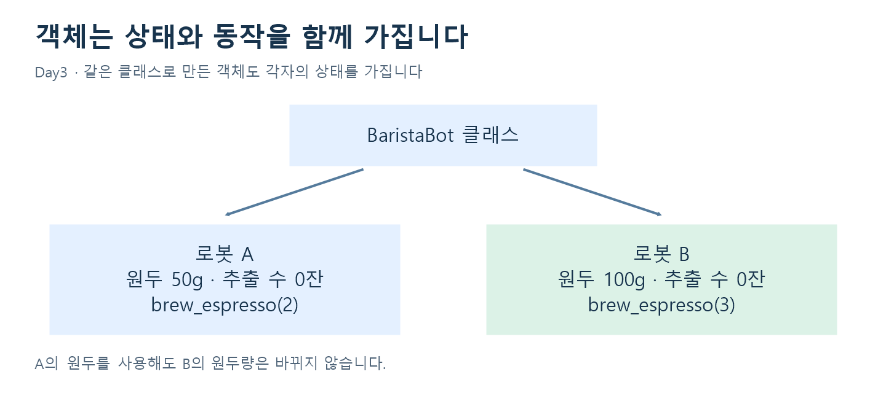

| 개념 | 수업 속 예 | 기억할 점 |
| --- | --- | --- |
| 생성자 `__init__` | 로봇 이름·원두 초기화 | 인스턴스 상태의 출발점 |
| 인스턴스 메서드 | `brew_espresso()` | `self`의 상태를 읽거나 변경 |
| property | 지갑의 balance | 읽기·쓰기에 규칙을 연결 |
| 상속·오버라이딩 | VisionClassifier, TextSummarizerLLM | 같은 predict 호출에 다른 동작 |
| 추상 클래스 | PaymentGateway | 공통 동작의 구현 의무 표현 |
| dataclass | PaymentReceipt | 필드 중심 데이터의 선언 간소화 |

`__balance`의 이름 맹글링은 실수 방지에 도움이 되지만 보안 경계는 아닙니다. 일반 클래스의 타입 힌트만으로 입력이 자동 검증되지도 않습니다.

**원본 점검:** `Day3/오전/day3-4.py`는 `@abstractmethod`를 사용하지만 `ABC`를 상속하지 않습니다. 추상 메서드의 구현을 강제하려면 다음처럼 작성합니다.

```python
from abc import ABC, abstractmethod

class PaymentGateway(ABC):
    @abstractmethod
    def process_payment(self, item: str, amount: int) -> str:
        pass
```

### 예외는 입력의 실패 원인을 구분하는 도구

로그 문자열을 split하여 dict로 만든 뒤 숫자로 변환하는 실습에서는 숫자 형식이 틀리면 ValueError, 키가 빠지면 KeyError가 발생합니다. 원본 `day3-1.py`는 split 전처리가 try 바깥에 있어 형식이 깨진 로그의 모든 오류를 처리하는 구조는 아닙니다.

- `try`: 실패할 수 있는 처리
- `except`: 해당 예외에 대한 대응
- `else`: try가 정상 종료되었을 때 수행
- `finally`: 예외 발생 여부와 관계없이 정리·기록

**주의:** `except Exception`으로 모든 문제를 같은 메시지로 바꾸면 원인이 감춰질 수 있습니다. 아는 오류를 좁게 처리하고, 원인 정보와 사용자용 설명을 구분하세요.

### 리팩터링 사례 두 가지

**주문 계산:** 등급 숫자를 Enum 이름으로 바꾸고 할인율을 한곳에 모읍니다. 가격·수량·쿠폰을 검증한 후 ‘등급 할인 → 쿠폰 차감 → 최소 0원 → 원 단위 버림’ 순서를 유지합니다. 수정본은 금액 계산에 정수 연산을 사용합니다. Python에서 bool은 int의 하위 타입이므로 bool 허용 여부도 별도로 판단합니다.

**점수 전처리:** 원본 `day3-4.py`는 키 누락·변환 실패·범위 초과를 방어하지 못합니다. `fixed`와 `after` 버전은 구조·키·bool·변환·유한수·0~100 범위를 검사합니다. 유효한 점수만 100으로 나누고, after 버전은 행별 오류와 성공률 등을 보고서로 만듭니다. 빈 입력의 평균이나 성공률은 계산 불가를 나타내는 None으로 처리합니다.

**직접 해보기:** `{"score": "N/A"}`, `{"score": 120}`, `{"score": True}`, `{}`를 왜 각각 거절해야 할까요? 잘못된 행을 건너뛰면 입력과 결과의 길이가 같을까요?

## 04 · Day4 — 값의 교환과 대입 순서

확인한 `Day4/day4-1`은 확장자 없는 Python 코드이며 난수 열 개를 만든 뒤 양끝 인덱스에 대입합니다.

```python
# 원본: 첫 값을 덮어쓴 뒤 같은 값을 다시 읽습니다.
numbers[0] = numbers[-1]
numbers[-1] = numbers[0]

# 교정 예제: 오른쪽 두 값을 먼저 평가하여 교환합니다.
numbers[0], numbers[-1] = numbers[-1], numbers[0]
```

| 단계 | 원본: [10,20,30] | 교정 예제 |
| --- | --- | --- |
| 시작 | [10,20,30] | [10,20,30] |
| 첫 대입 후 | [30,20,30] | 오른쪽에서 30,10을 먼저 준비 |
| 최종 | [30,20,30] | [30,20,10] |

**핵심:** 대입은 이전 값을 자동으로 기억하지 않습니다. `numbers[-1]`은 마지막 요소입니다. 이 예제는 길이 10의 리스트를 만들어 빈 리스트의 인덱스 문제는 발생하지 않습니다.

**직접 해보기:** `[3,7,9]`에 원본 두 줄을 실행한 결과와 교정 예제를 실행한 결과를 비교하세요.

### 🎬 쉬어가는 만화 1 — 파이썬 탐정단

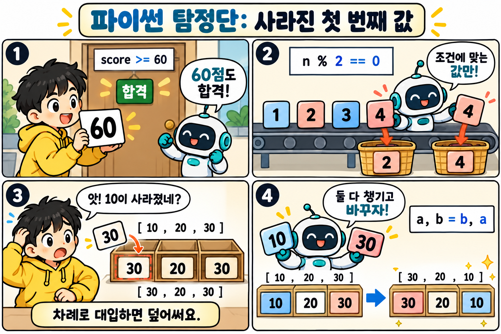

**만화 속 핵심:** 60점은 `>= 60`에 포함되고, `% 2 == 0`은 짝수만 고릅니다. 값을 차례로 덮어쓰면 처음 값이 사라질 수 있으므로 교환할 때는 오른쪽 값을 먼저 평가하는 `a, b = b, a`를 사용합니다. 3컷은 덮어쓰기 전후, 4컷은 올바른 교환 전후를 보여줍니다.

**한 줄 퀴즈:** `a=10`, `b=30`에서 `a=b; b=a`를 하면 두 값은 어떻게 될까요? → 둘 다 30입니다.

## 05 · Day5 — 원본 미확인 / FastAPI 보충 학습

**Day5 폴더는 없습니다.** 다음은 `05.FastAPI-uvicorn/labs/lesson01.py ~ lesson04.py`에서 확인한 보충 내용입니다. 폴더 이름의 05를 수업 날짜로 확정하지 않았습니다.

### 요청이 응답이 되기까지

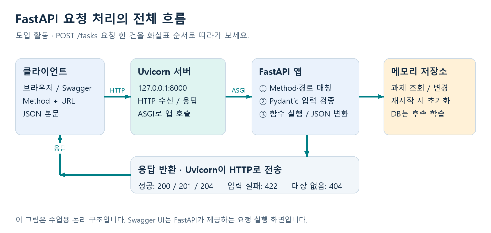

출처: 로컬 `05.FastAPI-uvicorn/assets/architecture.png`의 기존 수업 시각 자료.

Uvicorn이 서버를 실행하고 FastAPI가 메서드·경로에 맞는 함수를 찾습니다. 경로·쿼리·본문에서 입력을 받고, 처리 결과는 응답으로 전달됩니다.

```python
from fastapi import FastAPI

app = FastAPI()

@app.get("/")
def root():
    return {"message": "Hello FastAPI"}
```

`@app.get`은 모듈을 읽을 때 경로를 등록합니다. 함수 본문은 해당 요청이 들어왔을 때 실행됩니다. 해당 모듈이 `main.py`이고 그 폴더에서 실행한다면 `python -m uvicorn main:app --reload`로 개발 서버를 켭니다. `main`은 모듈, `app`은 그 안의 객체입니다. 다른 파일명이라면 명령도 달라집니다.

| 요청 | 위치·역할 | 보충 자료에서의 예 |
| --- | --- | --- |
| GET | 조회 | `/`, `/sports`, `/tasks` |
| POST | 생성·처리 | `/method`에 생성 성공 201 지정 |
| Path | 대상을 식별 | `/tasks/{task_id}` |
| Query | 검색·필터·페이지 조건 | `?q=Python&done=false&skip=0&limit=10` |

`/tasks/stats` 같은 고정 경로를 `/tasks/{task_id}`보다 먼저 선언하는 예제가 있습니다. 조회 목록은 검색·완료 필터를 적용하고 전체 개수를 계산한 뒤 `skip:skip + limit`로 일부를 가져옵니다. 루트 `/`는 각 앱에서 선언한 경우에만 존재합니다.

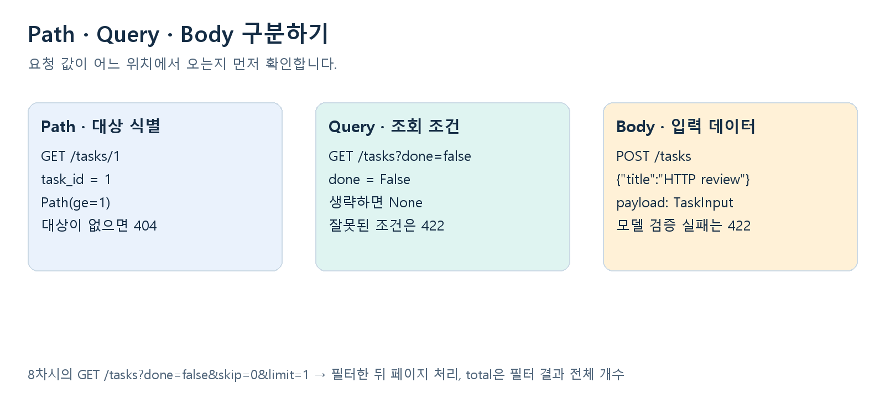

출처: 로컬 `05.FastAPI-uvicorn/assets/parameters.png`.

**직접 해보기:** `/items/3?qty=2`에서 Path 값과 Query 값을 각각 찾아보세요. Swagger의 `/docs`와 기계가 읽는 `/openapi.json`이 하는 일은 어떻게 다를까요?

## 06 · Day6 — Pydantic으로 데이터 검증

### 모델은 데이터의 규칙을 선언한다

일반 클래스의 `age: int`는 주로 설명과 정적 분석을 위한 힌트입니다. Pydantic의 BaseModel은 인스턴스를 만들거나 model_validate를 호출할 때 실제 데이터를 검사합니다.

```python
from pydantic import BaseModel, ConfigDict, Field

class Product(BaseModel):
    model_config = ConfigDict(extra="forbid")
    title: str = Field(min_length=2, max_length=60)
    price: int = Field(gt=0, strict=True)
    stock: int = Field(default=0, ge=0)
    sku: str = Field(pattern=r"^SKU-[0-9]{4}$")
```

위는 원본 실습의 TODO 조건에 맞춘 **교정 예제**입니다. 원본 `exercise.py`는 ‘가격 0보다 큼’이라는 주석과 달리 `ge=0`이라 0을 허용하고, product·ValidationError·main 정의도 빠져 있어 그대로 실행할 완성본으로 보면 안 됩니다.

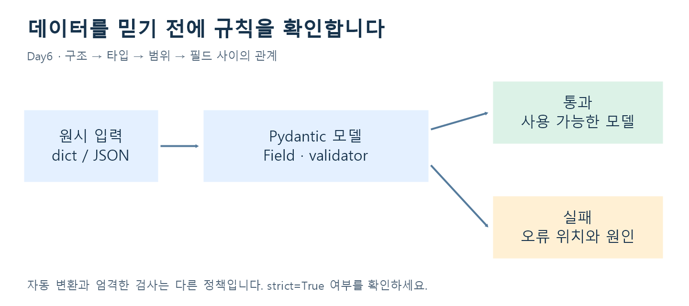

| 선언 | 의미 | 예 |
| --- | --- | --- |
| `age: int` | 필수 필드 | 일반 설정에서는 `"34"`를 34로 변환 가능 |
| `nickname: str \| None = None` | 생략·None 허용 | 선택 별명 |
| `value: int \| str` | 여러 타입 허용 | 정수·문자열 학번 |
| `gt=0` / `ge=0` | 0 초과 / 0 이상 | 가격 / 재고 |
| `strict=True` | 자동 변환을 제한 | 엄격한 정수 입력 |
| `extra="forbid"` | 정의하지 않은 필드 거절 | 오타 필드 발견 |
| `model_dump()` | 모델을 dict로 변환 | 출력·후속 처리 |

None을 허용하는 타입과 생략 가능한 필드는 같은 뜻이 아닙니다. `nickname: str | None`만 선언하면 값은 None일 수 있어도 필드는 여전히 필수이며, 생략까지 허용하려면 기본값을 지정해야 합니다.

### 필드·모델·중첩 검증

`field_validator`는 아이디 공백·소문자 정리나 태그 문자열 분해처럼 한 필드에 규칙을 둡니다. `mode="before"`는 타입 검증 이전의 입력을 다룰 수 있습니다. `model_validator(mode="after")`는 비밀번호 확인 일치, 예약 시작·종료일 순서처럼 여러 필드의 관계를 검사합니다.

원본 Reservation의 조건 `start > end`는 **종료일이 시작일보다 이르면 거절**한다는 뜻입니다. 원본 오류 메시지는 이 관계를 반대로 표현하므로 조건식을 기준으로 읽어야 합니다. 시작일과 종료일이 같은 경우는 이 조건에서 허용됩니다.

중첩 모델에서는 Order 안에 Address, `list[OrderItem]`, 배송 방식 Enum을 넣습니다. `ValidationError.errors()`의 loc는 예를 들어 `('items', 0, 'quantity')`처럼 잘못된 위치를 알려 줍니다.

**직접 해보기:** 가격 0, 재고 -1, SKU-001은 위 교정 모델에서 통과하나요? `"20"`과 20의 차이를 strict=True 적용 전후로 설명해 보세요.

### 🎬 쉬어가는 만화 2 — Pydantic 공항

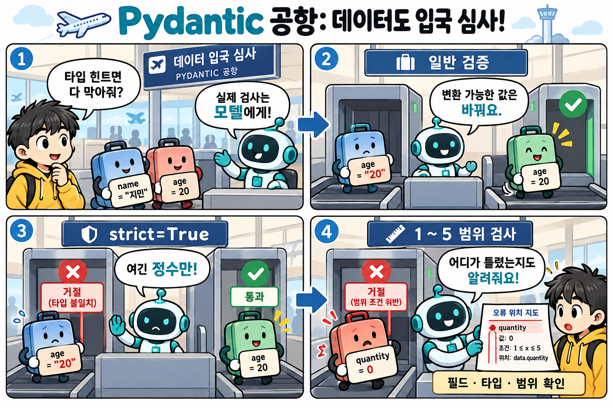

**만화 속 핵심:** 일반 클래스의 타입 힌트만으로 입력을 막지는 않습니다. Pydantic은 모델 생성 시 검증하며, 일반 정수 필드는 문자열 `"20"`을 20으로 변환할 수 있습니다. `int` 필드에 `strict=True`를 적용하면 문자열 `"20"`은 거절합니다. 범위 검사에서 수량 0은 1~5에 들어가지 않습니다. 만화의 ‘오류 위치 지도’는 설명용 표현이며 실제 오류 위치는 `ValidationError.errors()`의 `loc`에서 확인합니다.

**한 줄 퀴즈:** `price: int = Field(gt=0, strict=True)`에 `"100"`을 넣으면? → 문자열이므로 거절합니다.

## 07 · Day7 — 기다림을 겹치는 비동기 처리

### async는 어디서 기다리느냐가 중요하다

`async def`만 붙여도 모든 처리가 빨라지지는 않습니다. 이벤트 루프 안에서 `time.sleep(2)`를 직접 호출하면 다른 작업도 기다립니다. `await asyncio.sleep(2)`는 기다리는 동안 다른 작업이 진행될 기회를 줍니다. 기존 동기 I/O 함수를 유지해야 한다면 수업 예제처럼 `await asyncio.to_thread(...)`로 별도 스레드에 맡길 수 있습니다.

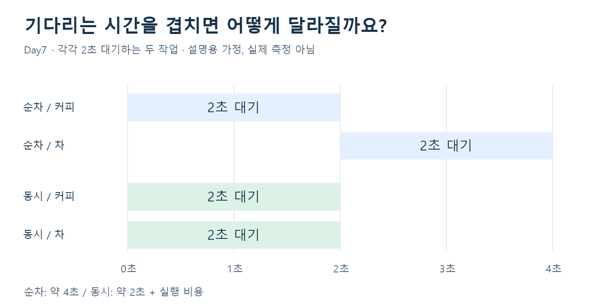

이 그림은 각각 2초씩 기다리는 두 작업의 **이론적 비교**이며 이번 작업의 실제 측정 결과가 아닙니다. 실제 시간에는 실행 비용·네트워크·서버 제한 등이 더해집니다. 동시성은 여러 I/O 대기를 겹치는 개념이며 CPU 계산의 병렬 실행을 자동 보장하지 않습니다.

```python
import asyncio

async def make_drink(name):
    await asyncio.sleep(2)
    return name

async def main():
    drinks = await asyncio.gather(
        make_drink("커피"), make_drink("차")
    )
    print(drinks)

asyncio.run(main())
```

### 외부 API를 읽을 때의 확인 순서

1. 연결과 타임아웃을 확인합니다.
2. `response.raise_for_status()`로 실패 HTTP 상태를 확인합니다.
3. JSON 변환이 가능한지 확인합니다.
4. dict·필수 키·필드 타입 등 업무에 필요한 응답 구조를 검증합니다.
5. 요청 ID와 응답을 함께 보관해 완료 순서가 바뀌어도 연결을 유지합니다.

**원본에서 찾은 점검 포인트**

- `Day7/02/main.py`의 `'f/todos/{todo_id}'`는 f-string이 아닙니다. 의도한 주소는 `f'/todos/{todo_id}'`입니다. `raise_for_status()`가 빠져 HTTPStatusError 처리도 기대대로 작동하지 않으며 실패 후 data가 정의되지 않는 경로도 주의해야 합니다.
- `Day7/03/main.py`는 as_completed로 완료된 순서대로 결과를 모은 뒤 원래 ID와 zip합니다. 응답이 2→3→1 순서로 끝나면 요청 ID가 잘못 연결될 수 있습니다. 작업이 `(item_id, data)`를 함께 반환하도록 바꾸면 관계를 보존할 수 있습니다.
- gather는 결과를 전달한 작업의 순서로 모으며, as_completed는 완료 순서로 처리합니다. 실패 전파·취소 정책은 별도로 설계해야 합니다.
- mock_api.py는 지연·404·503·깨진 JSON·필드 누락·429·재시도를 실험할 자료입니다. 파일에 시나리오가 있다고 해서 모든 방어 로직이 구현되어 있다는 뜻은 아닙니다.

**체험 자료:** `Day7/01/shop_concurrency`에는 blocking·async·thread 상품 조회를 비교하는 화면이 있습니다. 실행 경로는 실제 폴더를 기준으로 사용하세요. README에 있는 일부 예시 경로에는 `01`이 빠져 있습니다.

**직접 해보기:** 0.6초·0.1초·0.3초 작업을 동시에 시작하면 어떤 순서로 완료될까요? 번호를 함께 반환해야 하는 이유를 설명해 보세요.

## 08 · Day8 — 동작을 확인하는 API 테스트

Day8 안에는 **8개의 차시**가 있습니다. 이 차시 번호와 Day1~Day8의 날짜 구분을 혼동하지 마세요. 기대값은 현재 코드의 결과를 복사하지 않고 README의 업무 계약과 TEST_CASES.md에서 정합니다.

| 차시 | 핵심 질문 | 실제 소스에서 확인한 사항 | 검증할 결과 |
| --- | --- | --- | --- |
| 1 Swagger·OpenAPI | 호출되는 경로가 문서에도 있는가? | 현재 main은 include_in_schema=True | /greet 호출과 OpenAPI paths 모두 확인 |
| 2 Path·Query | 생략·끝값에서도 맞는가? | 현재 qty 기본값 1, 범위 1~5 | 생략·1·5 성공, 0·6 오류 |
| 3 요청 본문 | 타입·누락·추가 필드 정책은? | strict 정수와 extra=forbid 적용 | 정상 201, 잘못된 입력 422 |
| 4 AI 테스트 | 할인 경계를 놓치지 않았는가? | 현재 amount > 10000 | 10000 이상 1000원 할인 계약 대조 |
| 5 오류 응답 | 없는 상품이 200으로 위장되는가? | except Exception이 404를 삼킴 | 존재 200, 없음 404, 입력 오류 422 |
| 6 응답 계약 | 내부 정보가 나가는가? | ProfileOut에 internal_note 포함 | 공개 필드만 존재하고 내부 필드 부재 |
| 7 상태 시나리오 | 두 번째 생성이 첫 항목을 지우는가? | task_id를 항상 1로 사용 | 서로 다른 ID와 두 데이터 보존 |
| 8 종합 검증 | 실패 뒤 상태도 안전한가? | 좌석을 먼저 차감한 뒤 부족 검사 | 거절 후 남은 좌석·기존 예약 보존 |

**현재 코드와 과거 기록 구분:** 차시 1~3의 README·VERIFICATION에는 제작 당시 의도한 결함이 설명되어 있지만 현재 main.py는 이미 교정된 부분이 있습니다. 그 기록을 현재 실행 결과로 인용하지 않았습니다. 이번 정리에서는 코드를 읽어 분석했으며 전체 테스트를 새로 실행했다고 주장하지 않습니다.

### 문서와 실행 결과를 구분하기

Swagger UI의 Example Value는 예시입니다. Try it out → Execute 후 **Server response**가 실제 결과입니다. OpenAPI는 기계가 읽는 명세이며 문서가 생성되었다는 사실만으로 업무 규칙이 맞는지는 알 수 없습니다.

### 경계값: 10000원 할인

| 입력 금액 | 계약상 할인 | 계약상 결제액 | 현재 `> 10000` 코드 |
| --- | --- | --- | --- |
| 9999 | 0 | 9999 | 계약과 일치 |
| 10000 | 1000 | 9000 | 할인 0으로 불일치 |
| 10001 | 1000 | 9001 | 계약과 일치 |

교정 방향은 조건을 `amount >= 10000`으로 바꾸는 것입니다. 테스트 기대값을 잘못된 구현에 맞춰 바꾸면 결함을 놓칩니다.

```python
import pytest
from fastapi.testclient import TestClient
from main import app

client = TestClient(app)

@pytest.mark.parametrize("amount, payable", [
    (9999, 9999), (10000, 9000), (10001, 9001)
])
def test_discount_boundary(amount, payable):
    response = client.post("/quotes", json={"amount": amount})
    assert response.status_code == 200
    assert response.json()["payable"] == payable
```

이 예제는 lesson_04 폴더의 main을 대상으로 하는 설명용 검사입니다. 원본이 수정되지 않았다면 가운데 입력에서 실패할 것으로 코드상 예상됩니다.

### 실패 응답 뒤에도 상태가 맞아야 한다

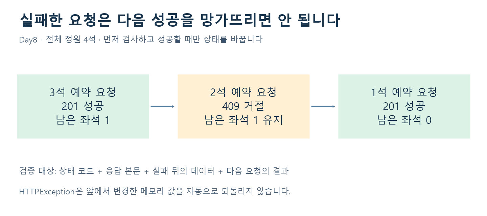

정원 4석에서 3석 예약 성공 → 2석 추가 예약 거절 → 1석 예약 성공이 되어야 합니다. 기대 상태는 201 → 409 → 201이며 잔여 좌석은 1 → 1 → 0입니다. 거절 전에 좌석을 빼면 실패가 다음 요청까지 망가뜨립니다. `raise HTTPException`은 앞서 변경한 메모리 상태를 자동으로 되돌리지 않습니다.

```python
# 교정 원리: 먼저 확인하고 성공할 때만 변경합니다.
if body.seats > app.state.remaining:
    raise HTTPException(status_code=409, detail="Not enough seats")
app.state.remaining -= body.seats
```

이 간단한 메모리 예제는 단일 프로세스 학습용입니다. 운영 환경의 동시 예약·여러 worker·영속성까지 보장하는 구현으로 확대 해석하지 않습니다.

### 테스트 실행과 기록

차시별 main 모듈 이름이 같으므로 각 lesson 폴더 안에서 `python -m pytest -q test_api.py`로 실행합니다. TestClient는 프로세스 안에서 app을 호출하므로 별도 Uvicorn 서버가 필요하지 않습니다. Swagger로 실행하는 서버의 메모리와 테스트의 메모리는 별개입니다. fixture로 테스트 간 공유 상태를 초기화하면 실행 순서에 따른 간섭을 줄일 수 있습니다.

좋은 검증 보고서에는 입력, 계약상 기대값, 실제 상태·본문, 수정 전 실패, 수정 이유, 수정 후 회귀 결과, 미검증 범위를 함께 적습니다. AI가 만든 테스트도 정상·경계·오류·필드 부재·상태 변화의 누락을 검토해야 합니다.

### 🎬 쉬어가는 만화 3 — 카페 API의 하루


**앞의 세 컷:** 이벤트 루프에서 동기 `time.sleep`을 직접 실행하면 다른 작업도 막힙니다. 비동기 대기 중에는 다른 작업이 진행할 수 있고, 먼저 끝난 결과라도 원래 요청 번호와 함께 보관해야 합니다. 만화의 1초·5초는 설명용 대기 시간이며 실제 측정값이 아닙니다.

**뒤의 세 컷:** 정원 4석에서 A의 3석 예약 후 잔여 1석 → B의 2석 요청 거절 후에도 잔여 1석 → C의 마지막 1석 예약 후 잔여 0석입니다. 기대 상태는 **201 → 409 → 201**입니다. 실패 응답뿐 아니라 장부와 다음 정상 요청까지 확인하는 것이 핵심입니다.

**한 줄 퀴즈:** 409를 반환하면 앞에서 변경한 메모리도 자동으로 되돌아갈까요? → 아닙니다. 먼저 검사하고 성공할 때만 상태를 변경해야 합니다.

## 🧩 종합 연결 — 작은 방명록

`Day1-Day8`은 원본 날짜별 수업 폴더와 구분되는 결과물입니다. README·ANALYSIS에서 Python 조건·반복, Pydantic 입력 검증, FastAPI 라우트, SQLite 저장과 HTML 응답을 연결한 사례를 확인할 수 있습니다.

**폼 입력 → 길이·형식 검사 → Pydantic 검증 → SQLite 저장 → 303 이동 → 목록 HTML**

글 전체 최대 1000개, 한 페이지 20개, 작성자 1~20자·내용 1~1000자 등의 정책은 이 방명록의 규칙입니다. 모든 수업에 공통인 규칙은 아닙니다. SQL 매개변수와 HTML escape는 각각 저장 단계와 화면 출력 단계의 문제를 다룹니다.

## ✅ 복습 답안과 체크리스트

| 질문 | 확인할 답 |
| --- | --- |
| Day1: 59·60·61 | 불합격·합격·합격. 짝수 2·4의 합 6, 개수 2 |
| Day2: 20·15·60 | 변환: 성인·미성년·성인 / 필터: 20·60 |
| Day3: 잘못된 점수 | 변환 불가·범위 초과·bool·필수 키 누락. 행을 제외하면 길이는 달라질 수 있음 |
| Day4: [3,7,9] | 원본 [9,7,9] / 교환 [9,7,3] |
| 보충 FastAPI: /items/3?qty=2 | Path는 3, Query는 qty=2 |
| Day6: 가격·재고·SKU | 교정 예제에서 0·-1·SKU-001은 각각 거절 |
| Day7: 완료 순서 | 같은 시각에 시작했다는 가정에서 0.1 → 0.3 → 0.6초 |
| Day8: 예약 후 잔여 | 1 → 1 → 0. 실패가 상태를 바꾸면 안 됨 |

- [ ] 변수·조건·반복으로 작은 문제를 해결할 수 있다.
- [ ] 필터링과 값 변환의 차이를 설명할 수 있다.
- [ ] 객체의 상태와 메서드를 구분할 수 있다.
- [ ] 예외를 원인에 따라 분리하고, 메시지로 오류를 숨기지 않는다.
- [ ] 일반 타입 힌트와 Pydantic 실행 검증을 구분할 수 있다.
- [ ] Path·Query·Body의 위치와 검증을 설명할 수 있다.
- [ ] blocking·async·thread의 대기 방식을 설명할 수 있다.
- [ ] 정상·경계·오류·상태 변화에서 기대값을 먼저 정할 수 있다.
- [ ] 현재 소스와 과거 검증 기록을 구분할 수 있다.

## 📚 원본 위치와 공식 참고 자료

로컬 원본 기준 경로는 `C:\Users\Playdata\dev`입니다. Notion에서 로컬 경로가 웹 링크처럼 열리지는 않으므로 아래 경로는 파일을 찾기 위한 표기입니다.

- Day1: `Day1/day1-1.py ~ day1-5.py`
- Day2: `Day2/오전/day2-1.py ~ day2-8.py`, `Day2/오후/day2-1.py ~ day2-4.py`
- Day3 객체: `Day3/오전/day3-1.py ~ day3-4-1.py`
- Day3 예외·리팩터링: `Day3/오후/day3-1.py ~ day3-4*.py`
- Day4: `Day4/day4-1`
- FastAPI 보충: `05.FastAPI-uvicorn/labs/lesson01.py ~ lesson04.py`, `fastapi_win_vscode/labs`
- Day6: `Day6/basemodel`, `Day6/ch04_validator/demo.py`, `Day6/ch05_nested`
- Day7: `Day7/01`, `Day7/02`, `Day7/03`
- Day8: 각 lesson의 `README.md`, `main.py`, `solution.py`, `TEST_CASES.md`, `test_api.py`, `VERIFICATION.md`
- 종합 사례: `Day1-Day8/README.md`, `Day1-Day8/ANALYSIS.md`

아래 공식 자료는 개념을 재확인하거나 심화할 때 사용합니다. 로컬 requirements의 수업 버전과 웹 최신 문서의 버전은 다를 수 있습니다.

- [Python — 클래스](https://docs.python.org/3/tutorial/classes.html): 데이터와 동작을 묶는 객체의 기본 개념.
- [Python — 코루틴과 태스크](https://docs.python.org/3/library/asyncio-task.html): async/await·gather·as_completed·to_thread의 세부 동작.
- [Pydantic — Validators](https://docs.pydantic.dev/latest/concepts/validators/): 필드·모델 검증과 실행 순서.
- [FastAPI — Query Parameters](https://fastapi.tiangolo.com/tutorial/query-params/): 쿼리 입력·기본값·필수 여부.
- [FastAPI — Request Body](https://fastapi.tiangolo.com/tutorial/body/): 모델 기반 JSON 본문 처리.
- [FastAPI — Response Model](https://fastapi.tiangolo.com/tutorial/response-model/): 응답 검증·문서화·필드 제한.
- [FastAPI — Handling Errors](https://fastapi.tiangolo.com/tutorial/handling-errors/): HTTPException과 오류 응답.
- [FastAPI — Testing](https://fastapi.tiangolo.com/tutorial/testing/): TestClient와 pytest의 기본 사용.

**시각 자료 출처:** 직접 제작한 도식 6개, 내장 이미지 생성 도구로 제작한 전체 아키텍처 1장과 카툰 시트 3장, 기존 로컬 교안 이미지 2개를 사용했습니다. 생성 프롬프트는 함께 저장한 `이미지_생성기록.json`에 있습니다. 동시성 시간은 설명용 가정이며 실제 측정 데이터가 아닙니다. 기존 이미지는 수업 자료에서 가져온 것으로 원저작자·외부 재배포 권한은 별도로 확인하지 않았습니다.
